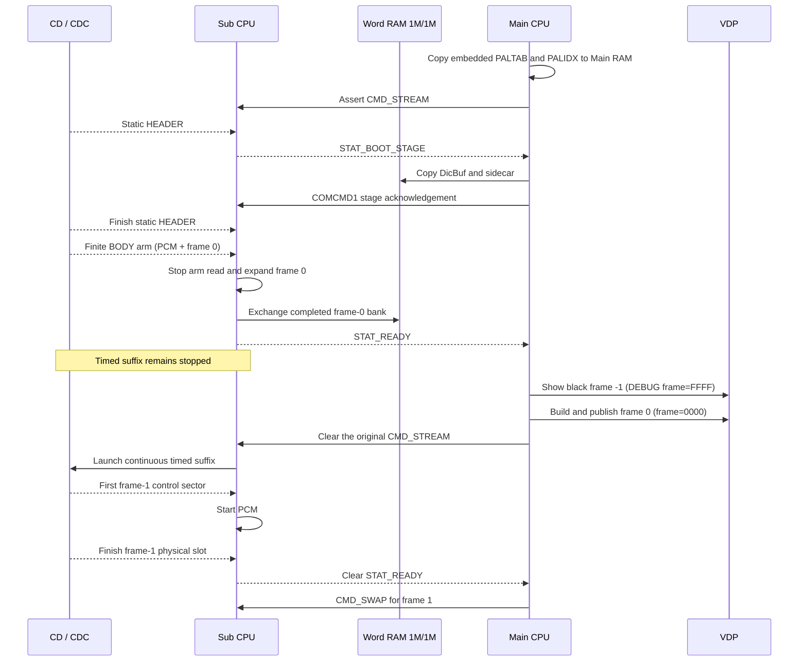
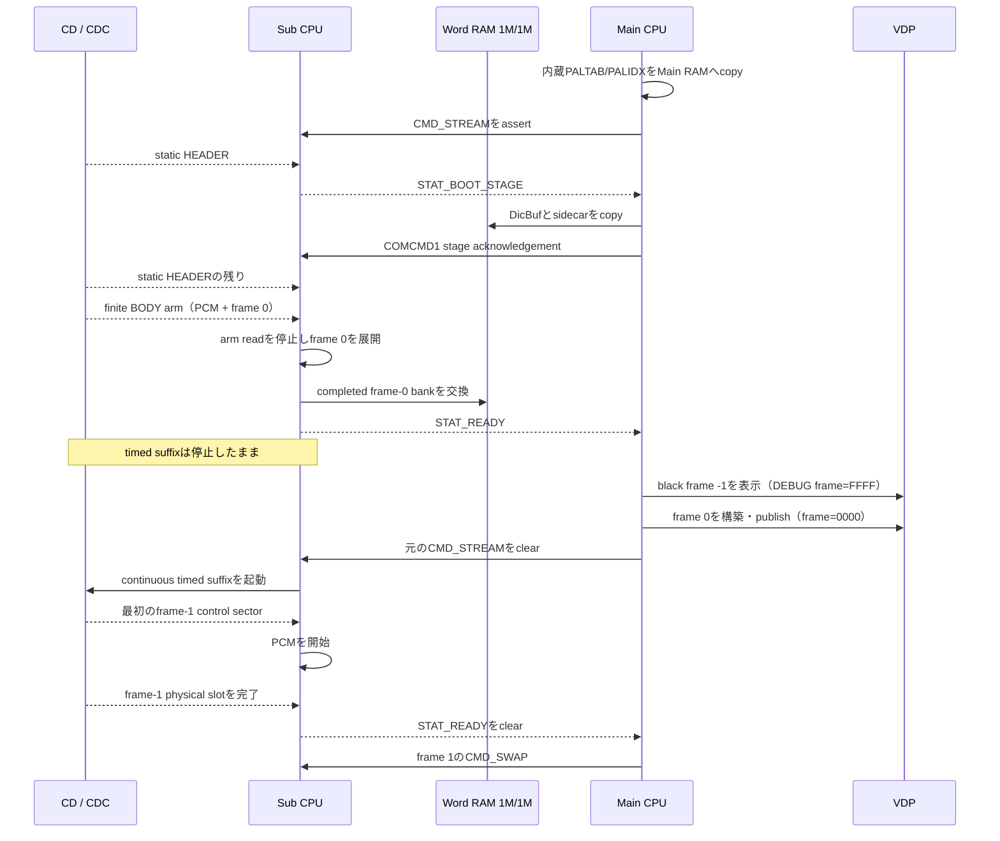
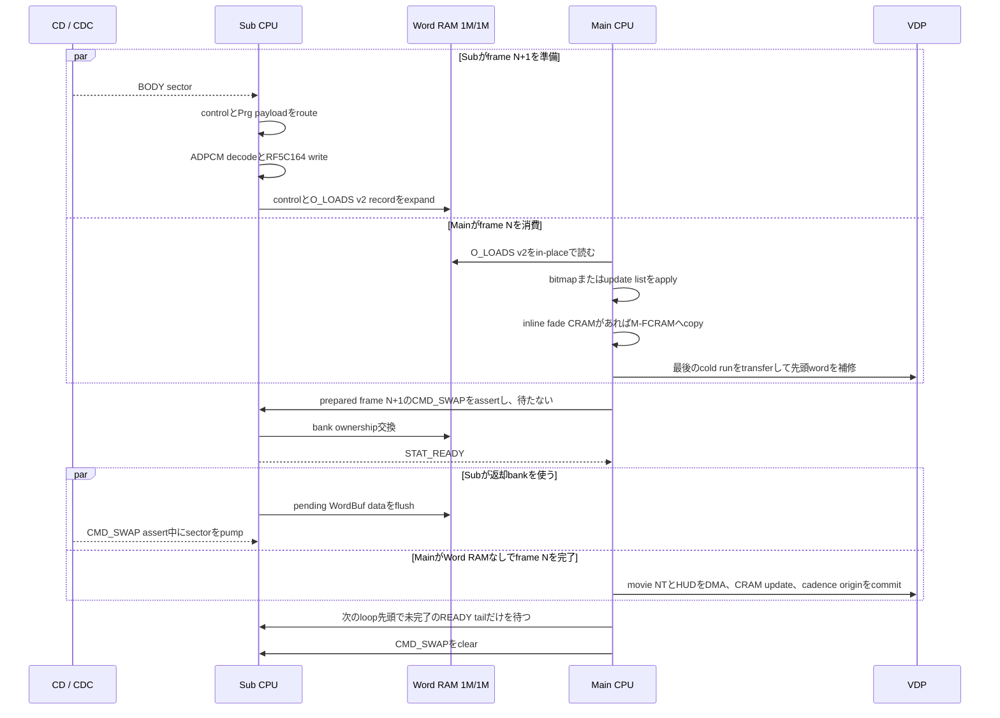

EN / [JP](#jp)

# Player Memory Maps and Runtime Sequence

This document describes the player as currently built: the Sub PRG-RAM,
Word RAM 1M/1M, and Main RAM maps, the startup sequence, and the per-frame
CPU handoff. Each map row carries a short range name (shown as `CODE`) so a
range can be referenced unambiguously in issues, commits, and reviews.

**fps dependence.** Across 15, 24, and 30 fps content, the only address-map
difference is the `PRG-BUF` / `JITTER` split inside the fixed
`0x0D800..0x74FFF` region; that split is the one place below where both
15 and 30 fps values are listed side by side. Every other row of every map,
and the whole startup / per-frame sequence, apply at all three rates. Word-RAM
WordBuf and routing sizes vary by
profile (frame count, cell count, cold cap), not by fps.

**Display cadence.** The player derives one authoritative repeating VBlank
schedule from the packed header. The 15 fps path repeats `(4)`, 24 fps repeats
`(2, 3)` beginning with two VBlanks from frame 0 to frame 1, and 30 fps repeats
`(2)`. Main's display deadline and Sub's CD-sector allowance advance in the
same phase. Their effective rates are 15000/1001, 24000/1001, and 30000/1001
fps respectively.

The fixed 15/30 fps display controller counts missed whole VBlanks as debt.
It retains up to one VBlank of lateness as preparation headroom. Later frames
shorten their display interval, never below one VBlank, to recover only debt
above that allowance. Full debt remains counted, including the retained unit;
the allowance resets at each movie start and does not grow with each stall.
The retained unit can shift video by about 16.7 ms relative to the original
display schedule; it does not move or replace audio samples.
Pattern and final-display DMA admission still use the
remaining budget of the actual target blank. A frame that cannot finish sooner
retains its debt; the display cannot advance ahead of the nominal stream clock.
Before reserving an early publication blank, Main requires all pattern words,
one CPU repair per run and the final-display reserve to fit one VBlank budget
plus one bounded active transfer allowance (at most 672 word-cost units).
This workload estimate does not grant transfer capacity: active entry still
uses the actual scanline limit, and publication must fit the actual remaining
blank time. Otherwise Main retains the nominal target and avoids wasting an
earlier reserve.

Fixed cadence is a target, not a guarantee of uniform display intervals. In
the e198/p169 DEBUG emulator qualification of the 2,714-frame Sonic Jam opening
at cold cap 240, each of two complete loops had four three-VBlank intervals
and two compensating one-VBlank intervals; the other 2,706 measured intervals
were two VBlanks. Two long intervals were at the movie edges. Relative to the
frame-1 schedule, lateness stayed at one VBlank after the first stall except
for temporary two-VBlank excursions, including the last frame. Each new loop
reset the allowance. The streamed PRG jitter reserve peaked at 2 KiB, with no
APPLY backpressure.
Every movie frame appeared, with zero sector slips, control desynchronizations
or audio resynchronizations. This result qualifies transport and completeness,
but retains a display-cadence warning and is not a hardware measurement.

The matching 15 fps Machi opening qualification completed all 2,293 frames.
Of 2,291 measured interior intervals, 2,288 were four VBlanks, two were five,
and one was three. Synchronization error counters and APPLY backpressure
stayed zero; the streamed PRG jitter reserve peaked at 3 KiB. These bounded
captures establish the observed behavior, not a worst-case lateness bound for
arbitrary streams.

The 24 fps display controller remains phase-locked after a missed deadline.
The frame-1 flip starts lateness accounting after the CD startup interval and
sets the next display target to three VBlanks.
It counts whole-VBlank lateness as debt and repays that debt only by shortening
a later nominal three-VBlank display step to two. It never shortens a
two-VBlank step to one. The Sub CPU's physical `(2, 3)` sector schedule remains
unchanged; the late frame has already given the reader the extra physical time
that the compensating display step consumes. This prevents isolated display
misses from becoming permanent reader lead and filling the APPLY queue.

## RAM Copy Timing Reference

These are instruction-based estimates for copies among Main RAM, PRG-RAM,
and Word RAM, not measured hardware throughput or a player scheduling budget.
Use approximately 7.67 MHz for Main (NTSC) and 12.5 MHz for Sub.
For other Main clock rates, scale these estimates by the clock ratio.
MB/s below means 1,000,000 payload bytes/s, counting copied bytes once.

The per-frame and per-scanline columns use the project's nominal NTSC
display timebase: `60000/1001` display frames/s and 262 scanlines/display frame
(including blanking). One display frame is about 16.6833 ms and one scanline
about 63.6768 us. Calculate `B/display frame = B/s * 1001/60000` and
`B/scanline = B/display frame / 262` from the unrounded instruction rate,
then round to one decimal place. These are continuous-copy time equivalents,
not guaranteed whole-instruction completion counts, crystal-accurate timings,
or VBlank-only budgets. They inherit every no-wait/conditional-ceiling limit
of their source rate. A movie frame spanning N display frames provides N times
this time interval, before other work is deducted.

### Instruction cost

With no additional bus waits, aligned `move.l (a0)+,(a1)+` copies four bytes
in 20 CPU clocks, including instruction fetch, source reads, and destination
writes. A continuing `dbra` adds 10 clocks per iteration; setup and the final
iteration are excluded from these steady-state estimates.

| Copy loop | Clocks per payload block | Main MB/s | Main B/display frame | Main B/scanline | Sub MB/s | Sub B/display frame | Sub B/scanline |
|---|---:|---:|---:|---:|---:|---:|---:|
| Consecutive `move.l`, excluding loop control | 20 / 4 B | 1.534 | 25,592.2 | 97.7 | 2.500 | 41,708.3 | 159.2 |
| One `move.l` followed by `dbra` | 30 / 4 B | 1.023 | 17,061.5 | 65.1 | 1.667 | 27,805.6 | 106.1 |
| Eight `move.l` followed by `dbra` | 170 / 32 B | 1.444 | 24,086.8 | 91.9 | 2.353 | 39,254.9 | 149.8 |

The calculation is `bytes * CPU_Hz / clocks`. For a 32-byte pattern, the
copy instructions alone take 160 clocks: about 20.86 us on Main or 12.80 us
on Sub. These are baselines for this instruction sequence, not CPU-wide
maximum rates; a `movem` implementation needs its own accounting.

### Routes and ownership

The rates in this table all use consecutive `move.l` without loop control.
They assume no additional waits on instruction fetches or data accesses.
The Sega manual describes non-wait memory access when devices do not compete,
with Sub access to PRG-RAM and Word RAM as examples.

| Source and destination | Copying CPU | No-wait estimate | B/display frame | B/scanline | Access condition |
|---|---|---:|---:|---:|---|
| Main RAM to Main RAM | Main | 1.534 MB/s | 25,592.2 | 97.7 | Main bus available |
| PRG-RAM to PRG-RAM | Sub | 2.500 MB/s | 41,708.3 | 159.2 | Excludes arbitration with refresh/CDC DMA |
| Word RAM to Word RAM within the owned region | Sub | 2.500 MB/s | 41,708.3 | 159.2 | Sub owns that region |
| Word RAM to Word RAM within the owned region | Main | 1.534 MB/s | 25,592.2 | 97.7 | Main owns that region |
| PRG-RAM to/from Word RAM | Sub | 2.500 MB/s | 41,708.3 | 159.2 | Sub owns the target Word RAM region |
| Main RAM to/from Word RAM | Main | 1.534 MB/s | 25,592.2 | 97.7 | Main owns the target Word RAM region |
| Main RAM to/from PRG-RAM | Main | 1.534 MB/s, conditional ceiling | 25,592.2 | 97.7 | Main must acquire the Sub bus; additional access timing is unqualified |
| PRG-RAM to/from Word RAM | Main | 1.534 MB/s, conditional ceiling | 25,592.2 | 97.7 | Main must acquire the Sub bus and own the Word RAM region; additional access timing is unqualified |
| PRG-RAM to PRG-RAM | Main | 1.534 MB/s, conditional ceiling | 25,592.2 | 97.7 | Both addresses must be in the selected 128 KiB PRG window; additional access timing is unqualified |

Sub cannot directly access Main RAM. Main access to PRG-RAM requires a Sub
bus request/reset handshake and prevents concurrent Sub CPU execution.
Include bus acquisition and PRG window changes separately from payload copies.

In 2M mode, one CPU owns the full 256 KiB Word RAM. In 1M/1M mode, each CPU
owns a different 128 KiB bank. Swapping banks changes ownership without copying
their bytes. A CPU cannot directly copy WordBuf0 to WordBuf1 while remaining
in 1M/1M mode: staging and a bank exchange, or a mode change, are required.
Ownership covers the physical bank; WordBuf is a pattern sequence
within that bank, not a separate memory device.

For a design estimate, add loop control, address/index work, interrupts, bus
arbitration, and ownership waits to the instruction cost. Code location also
matters because instruction fetches use the bus. Validate the actual assembled
copy path before using these figures as deadline evidence. This table does not
describe PCM RAM, backup RAM, Z80 RAM, CDC transfers, or graphics operations.

### VDP DMA boundary

RAM-to-VDP transfers use a separate timing model. Sega's H40 memory-to-VRAM DMA
table gives 18 bytes per scanline during active display and 205 bytes per
scanline during VBlank. These are transfer capacities during those intervals,
not sustained whole-frame rates. The manual specifies words instead of bytes
for CRAM/VSRAM destinations. Use the player's VBlank budget described
below for admission. For every Word-RAM DMA chunk, use source `src+2`, full
length, and the normal destination, then repair the destination's first word
with the CPU. Main-RAM DMA needs no such repair.

### Sources

- [Motorola M68000 User's Manual](https://www.nxp.com/docs/en/reference-manual/MC68000UM.pdf), section 8, tables 8-3, 8-9, and 8-10: `MOVE.L`, `DBcc`, and `MOVEM` timing.
- [Sega Mega-CD manual collection](https://www.megadrive.org/elbarto/megacd/Official%20Sega%20CD%20Manual/segacd_toc.html), Outline p.4: CPU clocks.
- [Sega Mega-CD Hardware Manual](https://segaretro.org/images/5/51/Mega-CD_Hardware_Manual.pdf), printed pp.6–10, 14–18, 22–25, 56–57, and 61: arbitration, mapping, ownership controls, and Word-RAM VDP DMA precautions.
- [Sega Genesis Technical Overview](https://segaretro.org/images/1/18/GenesisTechnicalOverview.pdf), printed p.45: DMA transfer capacity by display mode.

## Unallocated Space Summary

These are the only ranges with no live owner data. Guards, reserves, and
jitter ranges elsewhere in the maps are allocated to their protective role
and are listed in place.

| Domain | Unallocated ranges |
|---|---|
| Sub PRG-RAM | `SP-GAP` 224 B, `SCRATCH` 256 B, and `RING-ALIGN` 448 B |
| Word RAM (each bank) | none — every complete sector is assigned; `WB-GAP` is a sector-rounding remainder, not an allocatable range |
| Main RAM | `M-FREE` 4.19 KiB; the 192 B cushion below `M-STACK` is a guard, not allocatable |
| VRAM | `0xDE80..0xDFFF` 384 B; unused Window/HScroll table rows remain reserved to those VDP structures. DEBUG shapes its HUD row with reg 18 only; reg 17 must stay 0 because Window row 24 cols 0-1 alias the HScroll table at `0xFC00`, which now carries nonzero scroll values |

## Sub PRG-RAM Map

PRG-RAM is 512 KiB at `0x00000..0x7FFFF`.

| Name | Address | Size | Contents |
|---|---|---:|---|
| `BIOS-LOW` | `0x00000..0x05FFF` | 24.00 KiB | BIOS / low PRG work area |
| `SP-RES` | `0x06000..0x073FF` | 5.00 KiB | BIOS-loaded resident specialized SP image; the linker rejects a larger image |
| `ADP-IDX` | `0x07400..0x07F1F` | 2,848 B | persistent ADPCM next-index table, copied once at boot; the full range is continuous-read marker-qualified |
| `SP-GAP` | `0x07F20..0x07FFF` | 224 B | unallocated marker-qualified tail |
| `PCM-BUF` | `0x08000..0x085FF` | 1.50 KiB | live decoded ADPCM buffer |
| `WORD-PENDING0` | `0x08600..0x08DFF` | 2.00 KiB | first Sub-owned sector waiting for its parity WordBuf bank |
| `WORD-PENDING1` | `0x08E00..0x095FF` | 2.00 KiB | second pending WordBuf sector |
| `ADP-OUT` | `0x09600..0x096FF` | 256 B | persistent predictor-high-byte to RF5C164 output lookup |
| `SCRATCH` | `0x09700..0x097FF` | 256 B | unallocated marker-qualified scratch; the SP-tail diagnostic installs its checker here |
| `BIOS-CD` | `0x09800..0x0BFFF` | 10.00 KiB | BIOS-touched during continuous reads |
| `ADP-DELTA` | `0x0C000..0x0D63F` | 5,696 B | persistent signed ADPCM delta table, copied once at boot |
| `RING-ALIGN` | `0x0D640..0x0D7FF` | 448 B | unallocated gap that sector-aligns PrgBuf |
| `PRG-BUF` | fps split, see next table | 374 / 394 KiB | streamed PrgBuf normal ceiling |
| `JITTER` | fps split, see next table | 40 / 20 KiB | live delivery-jitter reserve above the scheduled ceiling |
| `OBS-GUARD` | `0x75000..0x757FF` | 2.00 KiB | observation guard below pump back-pressure |
| `OVF-GUARD` | `0x75800..0x767FF` | 4.00 KiB | physical PrgBuf overflow guard |
| `WORD-PENDING3` | `0x76800..0x76FFF` | 2.00 KiB | third Sub-PRG pending destination (`WORD_PENDING3` in the player); the boot-only extension executes here before timed playback |
| `APPLY` | `0x77000..0x7F7FF` | 34.00 KiB | APPLY circular queue |
| `SUB-STACK` | `0x7F800..0x7FEFF` | 1.75 KiB | Sub stack reserve |
| `STACK-TOP` | `0x7FF00..0x7FFFF` | 256 B | area above the configured stack top |

### `PRG-BUF` / `JITTER` fps split

The physical bounds are fixed at every fps: the PrgBuf ring is 420 KiB at
`0x0D800..0x767FF`, pump back-pressure begins at 416 KiB, and the delivery
observation boundary is 414 KiB (`..0x74FFF`). Inside that fixed region the
normal/scheduled ceiling and the jitter reserve move with content cadence:

```text
normal PrgBuf KiB = 414 - cadence reserve KiB
cadence reserve KiB = ceil(20 * 30 / fps)
```

| Item | 15 fps | 30 fps |
|---|---|---|
| cadence reserve | 40 KiB | 20 KiB |
| `PRG-BUF` normal / scheduled ceiling | 374 KiB | 394 KiB |
| `PRG-BUF` address | `0x0D800..0x6AFFF` | `0x0D800..0x6FFFF` |
| `JITTER` address | `0x6B000..0x74FFF` | `0x70000..0x74FFF` |

Other rates follow the same formula (24 fps: reserve 25 KiB, ceiling 389 KiB,
`PRG-BUF` = `0x0D800..0x6EBFF`). The values come from
`cadence_jitter_reserve_kb()`, `prg_buf_cap_kb()`, and
`scheduled_delivery_cap_kb()` in `tools/av_config.py`; this document defines
no independent capacity. The `JITTER` reserve is kept for live sector-arrival
variation and is never encoder Supply.

### `SP-RES` usage

The 32 KiB disc system area places the SP source at offset `0x06000` and
reserves its final 5 KiB. The BIOS loads the exact linked image contiguously
at Sub PRG `0x06000`; it is not limited to one 4 KiB sector pair. The image
is profile-specialized (`PLAYER_SPECIALIZE`) and the linker enforces the hard
end at `0x07400`. Continuous-read marker qualification covers the reclaimed
`0x07400..0x07FFF` interval before `ADP-IDX` uses its leading 2,848 bytes.
Boot WordBuf write-cursor wrapping uses assembly-time constants, preserving
space for long-route builds without changing timed playback or this map.

The packer places the exact 1,108-byte hash-bound extension after the
8,800-byte ADPCM table in its existing five-sector padding. Sub stages that
image at `SP-STAGE` (`0x7B000`) and runs the extension from `0x7D260` in two
ways: its qualified first 88 bytes run from `EXT-RUN` (`0x76800`, the unused
timed-ring tail); when routing is at most 8 KiB, the second entry runs in
place at `0x7D2B8` after prebuffer, while longer-route builds copy the
complete extension first. The extension also initializes wave RAM from its
fixed `+0x300` entry at staged address `0x7D560`. These boot-only entries copy
all three ADPCM tables once to their Sub PRG destinations, prepare routing,
and initialize PCM plus the ring/APPLY/frame state. Frame-0 staging may then
overwrite both temporary extension locations.

### Boot-only overlays

| Name | Address | Phase |
|---|---|---|
| `ISO-SCR` | `0x67000..0x76FFF` | 64 KiB scratch image during ISO discovery only |
| `F0-STAGE` | `0x72000..0x7AFFF` | frame-0 pattern staging |
| `SP-STAGE` | `0x7B000..` | staged SP image containing the extension source |
| `ROUTE-MIRROR` | `0x7B000..0x7B7FF` | 2 KiB scratch for sector-wise mirroring of tables above 16 KiB, after HEADER EOF |
| `EXT-RUN` | `0x76800..0x76C53` | boot-only extension execution window; timed playback reuses its first sector as `WORD-PENDING3` |

`ISO-SCR` and `F0-STAGE` may overlap the timed ring tail, and `F0-STAGE` may
also overlap `APPLY`, because those timed owners are inactive in each boot
phase. Neither overlay changes the timed map.

Routing supports 1..83,520 frames and reserves only its sector-rounded
actual length in each Word bank. Tables above 16 KiB are loaded into the
frame-0 bank, then mirrored one sector at a time after HEADER EOF. This
boot-only scratch does not change the 420 KiB PrgBuf or 34 KiB APPLY bounds.
At 65,536 frames and above, WordBuf0/1 are disabled. A full 320x224 frame-0
output uses 35,872 bytes including alignment; the 82 KiB maximum route and
10,496-byte fixed tail leave 736 bytes after that output. Main/Sub frame
counters are 32-bit; the HUD displays their low 16 bits.
The specialized long-movie PCM frequency phase uses two bytes inside `SP-RES`;
its adjacent-FD writes obey the PCM internal-register spacing and preserve
the wave write cursor and source sample order. Short streams omit this state.

The APPLY queue retains deliberate back-pressure headroom; its unused
instantaneous occupancy is not a fixed allocation.

## Word RAM 1M/1M Map

There are two independent 128 KiB physical banks. Sub owns one bank while
Main owns the other. A bank swap exchanges ownership; it does not make one
copy simultaneously visible to both CPUs. This map varies by profile, not by
fps.

`tools/pattern_supply.py` derives the map from frame count, the final
source-grouped run plan, and cold cap. Routing occupies
`ceil(frames / 2048) * 2048` bytes at the bank end. The fixed tail is packed
immediately below routing:

| Name | Relative order, high to low | Size | Contents |
|---|---|---:|---|
| `ROUTE` | bank end | variable, sector-rounded | resident routing table |
| `SECT-STG` | next | 2,048 B | CD-sector stage / pad discard |
| `CTRL-SCR` | next | 8,192 B | linear control scratch |
| `DBG-HDR` | next | 256 B | DEBUG counters and copied header |

The front of each bank starts with `W-HDR`: `O_NRUN` and `O_NLOAD`, two bytes
each. `LOADS` (`O_LOADS`) follows at `+0x0004`. Main reads name updates
directly from `CTRL-SCR`; `O_CRAM`, `O_NUPD`, and `O_UPDS` do not exist.

Sub expands each on-disc four-byte source run into one 22-byte `O_LOADS v2`
record containing VDP-ready DMA length, registers, destination command, and
resolved source. Only Prg records carry their 32-byte-per-pattern payload
inline immediately after the record. Wr and Dic records point at their
persistent stores. Main reads this one cursor in place; it does not build or
copy a run table. The encoder splits a Wr descriptor at its parity WordBuf
ring end before packing. Sub therefore emits only linear source spans, and
Main can run each Word-RAM DMA without wrapping a source address.

| Record offset | Size | Value |
|---:|---:|---|
| `+0` | 2 B | DMA length in words (`patterns * 16`) |
| `+2`, `+4` | 2 B each | prebuilt VDP registers 93 and 94 |
| `+6` | 4 B | destination VDP command without the DMA trigger bit |
| `+10` | 2 B | raw destination byte address for split-run continuation |
| `+12`, `+14`, `+16` | 2 B each | prebuilt VDP source registers 95, 96, and 97 |
| `+18` | 4 B | raw Main-view source address; for Prg it equals the following inline-payload cursor |

`WORDBUF` starts after the parity-specific exact `LOADS` peak and ends before
the fixed tail. The encoder recomputes the even and odd maxima over every
frame as `32 * inline Prg patterns + 22 * runs`, writes both byte counts to
PSUP, and freezes the resulting starts in `player_constants.inc`. Only the
residual after that first reservation becomes WordBuf capacity, rounded down
to complete 2 KiB preload sectors. The two banks can therefore have different
starts and capacities; `WB-GAP` is the remaining sub-sector rounding space.

This is the standalone player's map. A profile's reduced `[resources]`
Word-RAM budget (see [`CONFIG.md`](CONFIG.md#resource-budget)) keeps the same
order inside the top `word_ram_bank_kib` of each bank, starts `W-HDR` and
`LOADS` at that budget's base, and passes the untimed frame-0 output through
several boot handoffs; the in-game player plays it (see
[In-game player](#in-game-player)).

During boot, `BOOT-STG` uses `+0x0000..+0x5FFF` for the optional boot-VRAM
sidecar records; `DIC-STG` uses `+0x6000..+0x9FFF` for DicBuf staging. The
palette table and switch table are not staged here: the Main-IP image embeds
`paltab.bin` / `palidx.bin` and copies both to `M-PALTAB` / `M-PALIDX` at
entry, before generated code reuses the transient `.startup` area. Sub
gives the staging bank to Main, Main copies the dictionary and optional VRAM
sidecar to their persistent homes, and Main returns the bank. Sub stops `HEADER.DAT` before
this handoff and restarts at the exact first unread sector after the return,
so the copy interval cannot create a sector slip. Sub then reads the finite
untimed BODY arm and expands frame 0; frame 0 and `WORDBUF` may overwrite the
temporary staging range safely. Dump diagnostics write list-form updates into
`CTRL-SCR`.

When starting HEADER, the BODY arm, or the timed suffix, Sub sets the expected
first MSF from the requested LBA plus 150. Buffered sectors older than that
first sector are acknowledged and discarded without consuming this file's
remaining count or issuing a recovery seek. They cannot establish a new file's
anchor, including on replay. A sector ahead of the expected first sector, or
a gap after an accepted sector, still triggers normal slip recovery. Recovery
seeks retain the existing file anchor. PCM stays stopped until the first timed
control arrives, and the timed suffix remains one continuous read.

Main clears its name-table stage at initial boot and every replay. Scroll
builds clear all 64x32 words, including hidden columns and rows that fine
scrolling can expose; frame 0 rebuilds the encoded picture afterward.

## Main RAM Map

Main RAM is `0xFF0000..0xFFFFFF`. This map is completely fixed: it is
identical in every build, profile, and fps. Generated code grows upward and is
build-time checked against the `M-STATE` base.

| Name | Address | Size | Contents |
|---|---|---:|---|
| `M-CODE` | `0xFF0000..0xFF66FF` | 25.75 KiB | permanent player, transient boot UI, generated bitmap handlers and guard |
| `M-STATE` | `0xFF6700..0xFF87FF` | 8.25 KiB | BSS, shadow, DEBUG HUD row, name-table stage (a persistent 4,096 B 64x32 plane band on a scroll build), scroll state (`scroll_next_h`/`scroll_next_v`/`scroll_h_dirty`), state; worst-case fixed reserve |
| `M-FCRAM` | `0xFF8800..0xFF887F` | 128 B | current inline fade CRAM image, copied before the consumed Word RAM bank is returned |
| `M-FREE` | `0xFF8880..0xFF993F` | 4.19 KiB | unallocated space (4,288 B) |
| `M-PALTAB` | `0xFF9940..0xFFB93F` | 8.00 KiB | 64-entry PALTAB (player-embedded paltab.bin) |
| `M-PALIDX` | `0xFFB940..0xFFBA3F` | 256 B | 64-entry palette-switch table, 63 switches + sentinel (player-embedded palidx.bin) |
| `M-DIC` | `0xFFBA40..0xFFFA3F` | 16.00 KiB | 512-pattern persistent DicBuf |
| guard | `0xFFFA40..0xFFFAFF` | 192 B | cushion below the stack guard |
| `M-STACK` | `0xFFFB00..0xFFFCFF` | 512 B | stack and interrupt reserve |
| `M-TOP` | `0xFFFD00..0xFFFFFF` | 768 B | area above stack top / BIOS reserve |

Permanent text/data ends before `0xFF2200`;
the generated handlers occupy `0xFF2200..0xFF4AFF`, leaving the rest of
`M-CODE` below `0xFF6700` available as its existing guard. The linker keeps
boot-only startup assets inside that generated-code area until initialization.
The realized `.bss` end inside `M-STATE` varies per build and profile;
build-time assertions keep it inside its fixed range. The full scroll DEBUG
24 fps build ends at `0xFF87FC`, leaving four reserved bytes. Main retains the bounded
final-run pointers but no WordBuf read cursor: Sub owns both parity cursors
and hands off already-resolved records.

## VRAM Map

The movie uses one displayed Plane A name table. No per-frame register-2
switch selects another table.

| Name | Address | Size | Contents |
|---|---|---:|---|
| blank tile | `0x0000..0x001F` | 32 B | fixed transparent tile 0 |
| resident pool | `0x0020..0xD9FF` | 1,743 tiles | contiguous movie-pattern slots 1–1,743 |
| HUD font | `0xDA00..0xDBFF` | 16 tiles | hexadecimal glyphs shared by DEBUG and release startup |
| sprite table | `0xDC00..0xDE7F` | 640 B | complete 80-record hardware SAT footprint at the highest 0x400-aligned base below the name table; DEBUG uses 24 B (3 records) |
| gap | `0xDE80..0xDFFF` | 384 B | unallocated VRAM |
| movie NT | `0xE000..0xEFFF` | 4 KiB | single 64x32 Plane A table |
| HUD Window row | `0xF000..0xF04F` | 80 B | first DEBUG row; one word per each of the 40 screen columns |
| horizontal scroll | `0xFC00..0xFC03` | 4 B | Plane A/B full-screen HScroll pair; zero outside a scroll window, rewritten every flip inside one |

VSRAM entries 0 and 1 carry the Plane A/B VScroll. The stream's scroll value
follows the `y - vscroll` convention while the VDP adds VSRAM to the line
counter, so the player writes the negated value; both pairs are zero outside
a scroll window and republished in the same VBlank as the band DMA.

Main expands the logical grid into a zero-gapped, 64-entry-pitch Main-RAM
stage. During the cadence-final VBlank it DMAs the contiguous band from the
grid's centered top-left cell through its final cell into `movie NT`. The
transfer length is `(rows - 1) * 64 + cols`: 1,192 words for 40x19 and 1,768
for the full-height 40x28 grid. Inside a scroll window the
DMA instead covers the full 64-column band — `rows * 64` words, or all 32
plane rows (2,048 words) on a vertical window. DEBUG then sends the first
screen-width HUD row to the Window table and its three spill digits as
sprites. Generic and specialized players use the same routes at every cadence.

## Multipart loader ownership

`MULTIPART` builds reserve overlays in the otherwise free regions below.
The ordinary movie map and the PrgBuf/APPLY capacities remain unchanged.

| Memory | Multipart use |
|---|---|
| Main `0xFF8880..0xFF98FF` | Copy/return stub; builder checks actual assembled length |
| Main `0xFF9900..0xFF990F` | Persistent magic, part index, cycle and visit counters; outside BSS and PALTAB |
| Sub `0x07F20..0x07F3F` | Dispatcher and selected HEADER/BODY extents |
| Sub `0x07F42..0x07F4D` | Selected SP extent and exact byte length |
| Sub `0x07F50..0x07F65` | Permanent 20-byte bank-switch stub and 2-byte BIOS interrupt/user return |
| Sub `0x07F70..0x07F77`, `0x07F80..0x07F87` | Loader read parameters and ISO directory/volume bounds |
| Sub `0x0D680..0x0D7FF` | EOF return routine; builder checks assembled length against 384 bytes |
| Sub `0x67000..0x76FFF` | Untimed root-directory scratch; later reused for exact SP staging |
| Each Word RAM bank, offset `0x00000..0x04FFF` | Transient 20 KiB Main dispatcher |
| Each Word RAM bank, offset `0x05000..0x09FFF` | Selected Main module staging |
| Each Word RAM bank, offset `0x1E000..0x1FFFF` | Transient 8 KiB Sub dispatcher, executing at `0xDE000` |

The BIOS starts a small resident Sub bootstrap at `0x6000`. It installs the
permanent stubs, places the Sub dispatcher in both physical Word RAM banks,
and redirects BIOS interrupt/user callbacks before overwriting the bootstrap.
Bank swaps execute from PRG RAM. The selected Main image becomes Main-visible
only after the swap; Main acknowledges after copying its last word. The Sub
module is copied by exact byte length into the 5 KiB resident SP slot, so the
sector-rounded ISO read cannot overwrite ADP-IDX.

After both modules start, ordinary movie boot owns Word RAM and replaces the
transient loader images with WordBuf/output data. At EOF Sub stops PCM and
enters its persistent return routine. Main requests the dispatcher and executes
its copy from the reserved stub. The loader is reloaded before choosing the
next part; the last wraps to part 1. Every movie resets its own BSS and restores
its own palette and pattern state. There is a loading pause, no menu, and no
15-second single-movie tail. Frame -1 remains untimed; frame 0 is displayed
before starting the timed suffix, and the first frame-1 control proves service
before PCM starts, independently for every part.

## In-game player

A game can play a CAVC movie between its own scenes with the in-game build:
a Sub module (`boot/movieplay_sp.s` assembled with `INGAME`, `MOVIES.BIN`)
and a Main module (`boot/ingame_ip.s`, `MOVIEM.BIN`). The stream must be
encoded with a reduced `[resources]` budget that fits the maps below
([`CONFIG.md`](CONFIG.md#in-game-player-build) builds them); `HEADER.DAT`
carries that budget (MOVIE.md, Resource budget) and the modules refuse any
other header. The game keeps its program, music driver and data; it lends the
resources below for the duration of one call and gets them back when the
call returns. The modules support one fixed VBlank cadence, no DicBuf and no
scroll windows; their assembly rejects other streams.

### Calling sequence

1. The game stops its music (Z80, YM2612, PSG and PCM are its own to stop)
   and leaves Word RAM in 2M mode owned by Main. Its data may occupy the low
   176,128 bytes of Word RAM.
2. The game's Sub program reads `MOVIES.BIN` to PRG-RAM `0x40000` and checks
   its header: `"CAVS"` at `+0`, interface version 1 at `+4`, link base at
   `+8` (must equal the load address), image bytes at `+12`, entry at `+16`.
   It calls the entry with `a0` pointing at four longs: `HEADER.DAT` LBA,
   `HEADER.DAT` sectors, `BODY.DAT` LBA, `BODY.DAT` sectors.
3. The game's Main program copies `MOVIEM.BIN` to its link base and checks
   `"CAVM"` at `+0`, version 1 at `+4`, link base at `+8`, image bytes at
   `+12` (to copy), Main-RAM bytes used at `+16` (image plus state), entry at
   `+20`. It calls the entry with `a0` pointing at the parameters below.
4. Both calls return when the last frame is on screen. Sub returns
   `d0.w` = 0 or `0xBAD1` (header refused), `d1.w` = sector slips,
   `d2.w` = control desynchronizations, preserving `d3-d7/a0-a6`. Main
   returns `d0.w` = 0 or `0xBAD1`, `d1.l` = frames published, `d2.w` =
   frames published after their VBlank, `d3.w` = largest lateness in VBlanks,
   `d4.w` / `d5.w` = Sub's slips / desynchronizations, preserving
   `d6-d7/a0-a6`. On return Word RAM is in 2M mode, owned by Main.

| Main parameter | Size | Meaning |
|---|---|---|
| `+0` | word | VRAM address of the movie's 64x32 name table (8 KiB aligned) |
| `+2` | word | VRAM address of the game's horizontal-scroll table |
| `+4` | word | the game's VDP register 0 as a register write (`0x80xx`); always restored |
| `+6`, `+8`, `+10`, `+12` | word | the game's registers 1, 2, 4 and 7 |
| `+14` | long | address of the level-6 jump-table target long (BIOS: `0xFFFD08`) |
| `+18` | word | bit 0: restore registers 1, 2, 4 and 7 before returning; otherwise the last movie frame stays up |

The two calls meet through the comm registers: Main writes `CMD_STREAM`
(`0x50`) and `CMD_SWAP` (`0x51`) to `0xA12010` and acknowledges boot
handoffs on `0xA12012`; Sub reports on `0xA12020` (`STAT_BOOT_STAGE`
`0x8001`, `STAT_READY` `0x8003`, `STAT_END` `0x8004`, `STAT_F0_CHUNK`
`0x8005`, `STAT_FAIL` `0x80FF`). The movie owns `0xA12010..0xA12013` and
`0xA12020..0xA12025` during the call; Sub clears `0xA12022/24` and Main
leaves `0xA12010` zero on return. Other comm words are not touched.

### Ownership during the call

| Domain | The movie uses | The game keeps |
|---|---|---|
| Main RAM | the Main module at its link base: 3,130-byte image plus 8,672 bytes of state, 11,804 bytes in all (008/009 builds, budget 16 KiB); the game's stack | everything else; the game's stack also carries the module's calls and its VBlank hook (about 256 bytes) |
| Sub PRG-RAM | `0x40000..0x7FFFF` (map below) | `0x00000..0x3FFFF`, including its own program and BIOS areas; the module runs on the game's Sub stack |
| Word RAM | 1M mode: the top 40 KiB of each bank (bank offsets `0x16000..0x1FFFF`) | 2M bytes `0x00000..0x2AFFF` (176,128), which no 1M offset at or above `0x16000` maps to |
| VRAM | tiles 1–1,279 (`0x0020..0x9FFF`), the 64x32 name table, the first entry of the game's horizontal-scroll table, VSRAM words 0–1, all of CRAM | everything else, including tile 0 |
| VDP registers | 0 (horizontal interrupt off), 1, 2 and 4 (both planes on the movie table), 7, 15, 19–23 | the rest; 11 (full-screen scroll), 12 (H40) and 16 (64x32 planes) must already be set |
| Main interrupts | mask `0x2500`; the level-6 target is the movie's hook, which does every VDP write inside the blank | the gate array's horizontal-interrupt vector (`0xA12006`), never written |
| Sub interrupts | mask `0x2000` and gate-array enables `0x3C` (BIOS CDC/CDD service) | its interrupt vectors; mask and `0xFF8033` are restored |
| Sound | RF5C164 channel 0 and wave RAM `0x0000..0x7FFF` (22.05 kHz ADPCM); all channels are keyed off at the end | Z80, YM2612 and PSG are not touched |
| Drive | BIOS reads of the two files; stopped on return | sectors of `BODY.DAT` can remain in the CDC buffer after STOP: the game's next read must check each sector's header (MSF) and drop strays, as the test host does |

On return the movie leaves VDP register 15 at 2, its last palette in CRAM,
its last frame in the pattern pool and name table, and zero scroll in
VSRAM 0–1 and the first horizontal-scroll entry; the game redraws what it
needs. Registers 0, 1, 2, 4 and 7, the interrupt mask and the level-6
target are the game's again.

### Sub PRG-RAM map (in-game)

| Range | Size | Owner |
|---|---:|---|
| `0x40000..0x414FD` | 5,374 B | Sub module image: code and state (link limit `0x417A0`) |
| `0x417A0..0x43A00` | 8,800 B | ADPCM tables, installed from the `HEADER.DAT` stage |
| `0x43A00..0x43FFF` | 1.5 KiB | decoded PCM chunk |
| `0x44000..0x7A7FF` | 218 KiB | PrgBuf (`RING_*`); scheduled ceiling 172 KiB at 15 fps |
| `0x7A800..0x7BFFF` | 6 KiB | three pending WordBuf sectors |
| `0x7C000..0x7FFFF` | 16 KiB | APPLY control queue |
| `0x71800..0x7A7FF` | 36 KiB | boot only: frame-0 pattern stage over the PrgBuf tail (the prebuffer ends at `0x6F000`) |
| `0x7C000..0x7FFFF` | 16 KiB | boot only: ADPCM-table and routing stages over APPLY |

### Word RAM (in-game)

Each 1M bank keeps the standalone order inside its top `word_ram_bank_kib`:
`W-HDR` and `LOADS` start at bank offset `0x16000`, WordBuf follows the
parity's `LOADS` peak (`player_constants.inc` `PC_WR0/1_OFFSET`), and the
fixed tail (`STATUS` `0x1CF00`, `CTRL-SCR` `0x1D000`, `SECT-STG`, routing at
the bank end) is unchanged. In the 2M view 1M word `w` of bank `b` is word
`2w + b`, so bank offsets from `0x16000` are 2M bytes from `0x2C000`; the
game's first 176,128 bytes and the 4 KiB gap above them stay intact. The boot
stage (`BOOT-STG`, sidecar records) also starts at `0x16000`.

Frame 0 is untimed. Its `O_LOADS` (about 35 KiB at 320x224) does not fit the
bank, so Sub writes it in chunks that each fill `[O_LOADS, WordBuf)`: after a
full chunk Sub hands the bank to Main and posts `STAT_F0_CHUNK`; Main
transfers the records in VBlanks, acknowledges on `0xA12012`, and Sub takes
the bank back for the next chunk. The last chunk travels with frame 0's
control in the ordinary `STAT_READY` handoff. Each record is the ordinary
22-byte `O_LOADS` v2 record with its inline payload.

### Main module

The module owns the level-6 interrupt for the whole call. Its hook reads the
gate array's stopwatch (`0xA1200C`) on entry and, before each DMA, checks
that the transfer still ends inside the blank (72 ticks, 34.8 lines, after
entry). It transfers the current frame's records, splitting a record at whole
patterns when the blank runs out, and publishes a frame (final-tail patterns,
the 64x32 name-table band in one DMA, CRAM) once its records are done and its
VBlank has come. Frame 1's publication anchors the cadence. A frame's records
start only after the preceding frame is on screen, and a frame is armed for
publication only after its records have started. Word-RAM DMA uses `src+2`
and rewrites the first word. Task level builds each frame's name-table shadow
(two 64-pitch shadows, 3,536 bytes each) from the control in the owned bank.

### Test host

`make ingame-disc` builds a disc whose boot program stands in for a game
(`boot/ingame_host_ip.s`, `boot/ingame_host_sp.s`): plane A `0xC000`, plane
B `0xE000`, sprites `0xF000`, horizontal scroll `0xF400`, H40, 64x32, a
level-6 frame counter and a horizontal interrupt every 96 lines, a pattern in
the low 176,128 bytes of Word RAM and a font at tile 1,400. Its Sub program
finds the files, then on request loads and calls the Sub module; its Main
program calls the Main module. After each play it shows two rows:
status, frames, late frames, largest lateness, slips, desynchronizations;
then Sub status, Sub slips, Word-RAM errors, VRAM errors (font and plane B),
an interrupt check (0 when both host interrupts run again) and the play count.
It plays the movie again five seconds later.
`harness/ingame_player` checks such captures.

## Startup and Per-Frame CPU Sequence

The sequences below are identical at 15, 24, and 30 fps; only the cadence
differs.

### Startup

The Main IP leaves the BIOS VBlank handler active until the resident Sub
program publishes `STAT_SUB_BOOTED` on `COMSTAT0`. The handler sends INT2
to the Sub CPU, allowing the North American Sega CD BIOS to finish loading
the Sub program after the Main IP has started. A multipart disc's first
entry waits for `STAT_LOADER_READY` from its Sub loader. Main then masks
interrupts and takes over the display.

One `CMD_STREAM` command spans the complete startup. The BOOT_STAGE ownership
exchange still uses `STAT_BOOT_STAGE` plus `COMCMD1`, because Main must copy
palette, switch table, dictionary, and sidecar data before Sub reuses that physical bank.
There is no separate frame-0/BODY-start handshake.

`STAT_READY` exposes the completed frame-0 bank while the timed CD reader is
still stopped. Clearing the original command after visible frame-0 publication
launches timed BODY service. PCM stays stopped through `ROM_READN` startup and
begins when the first frame-1 control sector arrives. Sub finishes that
physical slot before acknowledging the clear, so its remainder and the next
VBlank form the normal frame-0-to-frame-1 interval. Frame -1 therefore creates
no unplanned PrgBuf lead, and the CD startup interval does not advance audio.

Single-movie replay retains the final picture for 900 VBlanks, then publishes
black frame -1 before sending `CMD_STREAM`. HEADER reload can write boot-sidecar
patterns into VRAM slots referenced by the previous picture, so the movie
plane stays black throughout that untimed reload and frame-0 preparation.



Frame -1 is a player/HUD state only. It does not add a sim frame, a control
block, a routing entry, or a HUD TSV row.

### Timed playback

On every generic and specialized path, Main returns the consumed Word
RAM bank as soon as its final pattern and status reads are complete. The bank
exchange is started without blocking, before Main finishes the name-table,
HUD, CRAM, and publication work for frame `N`.

```mermaid
sequenceDiagram
    participant CD as CD / CDC
    participant S as Sub CPU
    participant W as Word RAM 1M/1M
    participant M as Main CPU
    participant V as VDP

    par Sub prepares frame N+1
        CD-->>S: BODY sectors
        S->>S: Route control and Prg payload
        S->>S: Decode ADPCM and write RF5C164
        S->>W: Expand control and O_LOADS v2 records
    and Main consumes frame N
        M->>W: Read O_LOADS v2 in place
        M->>M: Apply bitmap or update list
        M->>M: Copy inline fade CRAM to M-FCRAM when present
        M->>V: Transfer the final cold run and repair its first word
    end

    M->>S: Assert CMD_SWAP for prepared frame N+1; do not wait
    S->>W: Exchange bank ownership
    S-->>M: STAT_READY

    par Sub uses the returned bank
        S->>W: Flush pending WordBuf data
        CD-->>S: Pump sectors while CMD_SWAP remains asserted
    and Main finishes frame N without Word RAM
        M->>V: DMA movie NT and HUD, update CRAM, commit cadence origin
    end

    M->>S: At the next loop head, wait only for any unfinished READY tail
    M->>S: Clear CMD_SWAP
```

A zero residual wait means Sub completed the exchange during Main's remaining
display work. It does not mean that the exchange itself was free. Inline fade
CRAM is copied to `M-FCRAM` before the request, so Main makes no further access
to the returned bank after asserting `CMD_SWAP`. If a fade carries shadow
updates, Main consumes their list after copying CRAM and stages the updated
name table before returning the bank. Sub locates audio after the 128-byte
CRAM image and four bytes per update. Frame 0 keeps
the startup `CMD_STREAM` ownership through its publication, so frame 1 is
acquired by the ordinary synchronous request. The final frame is also excluded: Main
requests `STAT_END` only after that frame has become visible.
Non-specialized, periodic-cadence, and feature-clear paths use the same early
handoff once a future frame exists.

Sub starts expanding a timed frame after the preceding physical slot has been
drained, the current slot's required WordBuf refills are present, and APPLY
contains the complete control block. Extra control sectors queued for later
frames can arrive while expansion proceeds.

On a scroll build, a type-3 control takes a dedicated apply path: item 0
supplies the absolute HScroll/VScroll pair, and the remaining completed-list
items write directly into the persistent 64x32 plane band, leaving the
logical shadow untouched and skipping the stage expansion. The flip then
publishes the full plane band and both scroll pairs. On the first following
non-scroll frame the player compacts the tile-aligned final viewport back
into the logical shadow and rearms both scrolls at zero.

CAVC controls store `n_runs` immediately followed by compact source-aware
run descriptors. Sub keeps the existing CDC polling cadence while resolving
those descriptors into `O_LOADS v2`; Main schedules the expanded records
against the runtime residual budget. Fixed N is the healthy fresh-budget
count: N2 permits two and N4 permits four; opening another budget remains
bounded but raises a HUD warning. A light N4 frame may open only one or two
budgets and leave the remaining cadence windows empty. These counters record
explicit budget openings.

The whole-run Main path retains the VDP control-port address and final-tail
threshold across the loop. It writes adjacent length registers 93/94 and
source registers 95/96 as ordered word pairs with longword instructions.
Every DMA still rewrites its length and autoincrement, polls completion and
repairs the first destination word. This reduces CPU setup work per run
without changing the stream layout or transfer budgets.

For fixed-cadence playback, one transfer deadline can serve both
the final cold-run tail and display publication. The Main CPU uses a
conservative
3,200 DMA-word-equivalent budget for each VBlank. A DMA word
costs one unit. Every pattern run uses DMA. A Word-RAM DMA also pays four units
for its required CPU first-word repair. Main grants a budget only after waiting for a
new VBlank or while the V counter is still on its first blank line (`E0`).
Entering an already-running blank later never creates a full budget; Main
waits for the next head.

Within one movie-frame display interval, the final publication VBlank is
**LVB (Last VBlank)** and its immediately preceding active period is
**LAT (Last Active Time)**. All earlier active periods in that interval are
**EAT (Earlier Active Time)**; all earlier VBlanks are
**EVB (Earlier VBlank)**. EAT and EVB can each contain multiple periods.
These names identify cadence positions, not Word-RAM banks or transfer budgets.

Timed fixed and periodic cadence can use each EAT and LAT before the cadence's
publication blank. Main admits one window per physical active period, as soon
as that period and source preparation are ready, before line 208.
Its budget is the smaller of 672 units and six
units per remaining active line, including CPU repairs. The physical head
of the preceding publication blank, recorded for both shared and fresh blanks,
anchors the target interval. Main divides elapsed ticks by the physical
VBlank period and retains the last admitted ordinal, preventing repeated
grants within one active period. A consumed blank may wait into the next
active period; an expired interval cannot authorize a later active period. A usable EVB head
is retained; the VBlank flag clearing ahead of the line-counter wrap does not
skip the active period. Transfer admission
does not wait for the display flip arm or line 112.
672 units represent 1,344 DMA-equivalent bytes, not a pattern-count cap.
A single Word-RAM chunk pays four units for repair, leaving at most 1,336
payload bytes (41 complete 32-byte patterns plus 24 bytes of the next).
Each additional repaired chunk consumes four more units. A split DicBuf DMA
needs no repair and may use all 1,344 bytes (42 patterns).
Earlier pattern blanks remain usable. The actual cadence target, including
debt recovery, bounds admission; frame parity and Word-RAM bank parity do not.
Nominal N4 at 15 fps offers three EAT windows and one LAT window when work is
ready. These windows move existing protected loads earlier without increasing
the encoded cold cap. Frame 0 remains blank-first. Active windows grant
no additional VBlank budget, and HUD blank counters exclude them.

Slots 1731..1742 (VRAM `0xD880..0xD9FF`) are a bounded final-only tail.
The allocator may reclaim an old display identity there only after current
references have disappeared and no next-frame reuse or mandatory pin needs it.
All other cold destinations remain protected from the preceding display;
the packed reader independently checks that rule. Runs split at the tail
boundary. Main retains at most twelve pointers (48 bytes), two word counters,
and a word active-period ordinal, plus a word publication-blank timestamp:
56 bytes within the existing `M-STATE` allocation.

Final-only runs keep their Word-RAM bank until the publication blank.
A shared blank must have enough residual word budget and measured time for
the entire final pattern/setup and display bundle; otherwise Main waits for
a fresh blank before any destructive write.
Before any destructive write, both packing verification and Main require the
whole bundle to fit 3,200 units: actual pattern words, 96 units per final run
for setup/repair, and the complete NT/HUD/CRAM reserve. Main checks pointer
count, total words and destination end bounds. Invalid bundles stop before
overwriting old patterns. Once admitted, the tail, name table and display
updates run without a refill or additional VBlank wait. Main returns the bank
after the final tail DMA/repair; frames without tail runs retain the earlier
handoff. No CD service, PrgBuf, APPLY or WordBuf capacity is added by LAT.

Budgets 1 through the current cadence target minus one are available to
patterns. Before pattern work enters the target budget, Main withholds the
complete display reserve: the exact movie band, a 512-unit CPU timing guard, the
physical DEBUG HUD DMAs when present, and an optional CRAM replacement. CRAM
is written by the CPU, so its 64 words reserve 256 units. Full-height H40 uses
2,280 units in release or 2,332 in DEBUG; a palette switch raises those values
to 2,536 and 2,588. Thus an N2 DEBUG full-height H40 frame has 3,200 units in
VBlank 1 and 868 pattern units in VBlank 2, or 612 on a palette switch. A
40x19 DEBUG frame reserves 1,756 units, or 2,012 with a palette switch.
The guard covers HUD field patching, sprite construction and DMA command setup;
charging only the 52 HUD data words does not cover that CPU time.
A scroll build adds the fixed scroll term — the full-band excess over the
trimmed band plus 16 units for the CPU-written HScroll/VScroll pairs (40
units at full-height H40) — and a vertical window adds a further 256 units
at runtime for the wrapped plane rows. A scroll frame carries no inline CRAM
image, so the palette-switch variants never apply to it.

A DMA run crossing a residual boundary is split exactly there and continued
at the next fresh VBlank head, regardless of run length. After the pattern
tail, Main restores the withheld reserve and admits the shared
name-table/HUD/CRAM publication path only if the current phase is still inside
that same VBlank and its remaining time covers the complete publication
reserve. VBlank status is checked before and after the V counter, and terminal
lines `FC..FF` are rejected. Each physical budget also retains its Main-RAM
stopwatch origin. Main scales its remaining time against 3,200 units over
76 ticks, conservatively excluding first-line entry uncertainty from the
38-line NTSC blank. This avoids the repeated V-counter range and catches CPU
setup time that consumes blank time without reducing the residual word counter.
If any condition fails, Main waits for a fresh VBlank.

Main formats the stable DEBUG HUD fields before waiting for the first pattern
budget, including frames that use only one budget.
After the final pattern word, it patches only the transfer-final fields and
the resolved palette segment and first-budget exit in `dbg_row`. The exact-band movie NT DMA and the
Window/SAT HUD DMAs then run as separate members of the same admitted VBlank;
there is no CPU VDP-port HUD republish. Exact logical pattern
word counters cover runtime VBlank budgets 1 through 4; they remain separate
from the weighted capacity charge. `transfer_vblanks` exposes a fifth or later
budget. The admission check charges the exact physical words for each display
DMA.

Sub wait loops service a pending `CMD_SWAP` before another opportunistic
sector pump. CD pumping continues while Main is genuinely idle, but future
payload work cannot delay an already-pending handoff.

The editable slide illustration and its regeneration commands are in
[`harness/cpu_sequence/`](harness/cpu_sequence/README.md).
Its task positions are schematic, not measured timing boundaries.

## Reproducing the Map Measurements

Use the managed Python environment and an explicit profile:

```sh
tools/python.sh tools/check_player_ring.py \
  --constants out/PROFILE/player_constants.inc \
  --extension tmp/PROFILE/build/movieplay_sp_ext.bin \
  --extension-constants tmp/PROFILE/build/sp_extension.inc
make movieplay CONFIG=profiles/PROFILE.toml \
  DEBUG=1 MAIN_CODEGEN=1 PLAYER_SPECIALIZE=1

~/toolchains/mars/m68k-elf/bin/m68k-elf-size -A \
  tmp/PROFILE/build/movieplay_ip.o \
  tmp/PROFILE/build/movieplay_sp.o
```

The `SP-RES` loaded size is the linked size of
`tmp/PROFILE/build/movieplay_sp.bin`. Rebuild, pack with verification, and
complete the DEBUG recording and HUD gate before revising any address or
size in this document.

---

<a id="jp"></a>

# Player memory mapとruntime sequence

この文書は、現在ビルドされているplayerをそのまま記述します。Sub PRG-RAM、
Word RAM 1M/1M、Main RAMのmap、startup sequence、frameごとのCPU handoffが
対象です。各map行には短いrange名（`CODE`表記）を付けており、issue・commit・
reviewでrangeを曖昧さなく参照できます。

**fps依存について。** 15、24、30 fpsのcontent間でaddress mapが変わるのは、
固定領域`0x0D800..0x74FFF`内部の`PRG-BUF` / `JITTER`分割だけです。その分割
だけを後述の表で15 fpsと30 fpsの両値併記にします。それ以外のすべてのmap行と
startup / per-frame sequence全体は3 rateすべてに適用されます。
Word RAMのWordBufとrouting sizeはprofile（frame数、cell数、cold cap）で変わる
ものであり、fpsでは変わりません。

**Display cadence。** playerはpacked headerから正式な反復VBlank scheduleを1つ
導出します。15 fps pathは`(4)`、24 fps pathはframe 0からframe 1までの2 VBlankで
始まる`(2, 3)`、30 fps pathは`(2)`を反復します。Mainのdisplay deadlineとSubの
CD-sector allowanceは同じ位相で進みます。実効rateは順に15000/1001、24000/1001、
30000/1001 fpsです。

固定15/30 fpsのdisplay controllerは、遅れたVBlank数をdebtとして数えます。
準備の余裕として最大1 VBlankの遅れを残し、後続frameはその許容分を超えたdebtだけを
表示間隔の短縮で返済します。表示間隔は1 VBlank未満にはしません。
残した1 VBlankも含めてdebtの全量を記録します。許容分はmovie開始ごとにresetし、
stallのたびに増やしません。残した1 VBlankによって映像は元の表示予定から約16.7 ms
後ろへずれ得ますが、音声sampleの位置や内容は変えません。
patternと最終表示DMAのadmissionには、実際のtarget blankの残budgetを引き続き使います。
早く完了できないframeのdebtは残り、名目stream clockより先に表示を進めません。
早い表示用のblankを予約する前に、Mainは全pattern word、runごとのCPU先頭word補修、
最終表示の予約分が1 VBlank budgetと1回分のActiveTime転送枠（最大672 word-cost単位）
へ収まることを確認します。この負荷見積もり自体は転送容量を許可しません。ActiveTime
の転送枠は実際の走査線で制限し、表示処理はblankの実際の残り時間に収まる必要があります。
見積もりが収まらなければ名目のtargetを維持し、早いblankの予約枠を無駄にしません。

固定cadenceは目標であり、均一な表示間隔を保証するものではありません。
e198/p169のDEBUG emulatorでcold cap 240、全2,714 frameのSonic Jam openingを
2周検証したところ、各周に3 VBlankの表示間隔が4回、その超過分を取り戻す
1 VBlankの間隔が2回あり、残りの計測対象2,706間隔は2 VBlankでした。
長い間隔のうち2回はmovieの端です。frame 1を基準とする表示予定に対して、
最初のstall後は1 VBlankの遅れを維持し、最終frameを含む一時的な箇所で
2 VBlankになりました。各周の開始時に許容分をresetしています。
streamed PRGのjitter reserve使用量は最大2 KiB、APPLY backpressureは0でした。
全movie frameを表示し、sector slip、
control desynchronization、audio resynchronizationはすべて0でした。この結果は
配送と全frameの表示を確認するもので、表示cadenceの警告は残り、実機計測ではありません。

同じ版の15 fps Machi opening検証では、全2,293 frameを完走しました。
計測対象の内部2,291間隔のうち、4 VBlankが2,288回、5 VBlankが2回、
3 VBlankが1回でした。同期error counterとAPPLY backpressureは0、streamed PRGの
jitter reserve使用量は最大3 KiBでした。この有限長の録画は観測した動作を確認する
ものであり、任意のstreamでの最大遅延を保証するものではありません。

24 fps display controllerはdeadlineを外した後も位相を維持します。遅れをVBlank単位の
debtとして数えるのはCD起動待ちが終わったframe 1の表示切り替えからで、次の表示間隔の
目標は3 VBlankです。後の名目3 VBlank display stepを2へ短縮する場合だけdebtを返済します。
2 VBlank stepを1へ短縮することはありません。Sub CPUの物理`(2, 3)` sector scheduleは
変えません。遅れたframeがreaderへ追加の物理時間をすでに与えており、補償display stepは
その時間を消費します。これにより、単発のdisplay missが恒久的なreader leadとなって
APPLY queueを満たすことを防ぎます。

## RAM コピー時間の参照値

ここでは Main RAM、PRG-RAM、Word RAM 間のコピーを命令時間から見積もります。
実機の測定値や player のスケジュール予算ではありません。
Main は約 7.67 MHz（NTSC）、Sub は 12.5 MHz とします。
Main のクロックが異なる場合は、その比率で換算します。
MB/s は 1,000,000 バイト/秒で、コピーしたデータ量を 1 回だけ数えます。

フレームあたりと走査線あたりの列には、プロジェクトの公称 NTSC 表示時間を使います。
表示周期は `60000/1001` フレーム/秒、1 表示フレームはブランキングを含む 262 走査線です。
1 表示フレームは約 16.6833 ms、1 走査線は約 63.6768 us です。
丸める前の命令速度から `B/表示フレーム = B/秒 * 1001/60000`、`B/走査線 = B/表示フレーム / 262` を計算し、小数第 1 位に丸めます。
これは連続コピーの時間換算値で、命令単位の完了量を保証する値、水晶発振器に基づく厳密な時間、VBlank のみの予算ではありません。
換算後も、元の速度のウェイトなしという仮定や条件付き上限の制約を引き継ぎます。
動画の 1 フレームが N 表示フレームにまたがる場合、他の処理時間を差し引く前の時間枠は N 倍になります。

### 命令のコスト

追加のバス待ちがなければ、偶数アドレスの `move.l (a0)+,(a1)+` は 4 バイトを 20 CPU クロックでコピーします。
この値は命令の読み込み、転送元の読み出し、転送先への書き込みを含みます。
繰り返しを継続する `dbra` は 1 回につき 10 クロックを加えます。
以下の定常速度では初期設定と最終反復を除きます。

| コピーのループ | データ量あたりのクロック数 | Main MB/s | Main B/表示フレーム | Main B/走査線 | Sub MB/s | Sub B/表示フレーム | Sub B/走査線 |
|---|---:|---:|---:|---:|---:|---:|---:|
| `move.l` の連続実行。ループ制御を除く | 20 / 4 B | 1.534 | 25,592.2 | 97.7 | 2.500 | 41,708.3 | 159.2 |
| `move.l` 1 回の後に `dbra` | 30 / 4 B | 1.023 | 17,061.5 | 65.1 | 1.667 | 27,805.6 | 106.1 |
| `move.l` 8 回の後に `dbra` | 170 / 32 B | 1.444 | 24,086.8 | 91.9 | 2.353 | 39,254.9 | 149.8 |

計算式は `バイト数 * CPU_Hz / クロック数` です。
32 バイトのパターンはコピー命令だけで 160 クロックかかり、Main では約 20.86 us、Sub では 12.80 us です。
これはこの命令列の基準値で、CPU 全体の最高速度ではありません。
`movem` を使う実装は、その命令列について別に計算します。

### 経路と所有権

この表ではすべて、ループ制御を除いた `move.l` の連続実行を基準にします。
命令の読み込みにもデータアクセスにも追加待ちがないと仮定します。
セガの資料は、他デバイスとの競合がなければメモリアクセスはウェイトなしとし、Sub から PRG-RAM と Word RAM へのアクセスを例示しています。

| 転送元と転送先 | コピーする CPU | ウェイトなしの計算値 | B/表示フレーム | B/走査線 | アクセス条件 |
|---|---|---:|---:|---:|---|
| Main RAM → Main RAM | Main | 1.534 MB/s | 25,592.2 | 97.7 | Main のバスが利用可能 |
| PRG-RAM → PRG-RAM | Sub | 2.500 MB/s | 41,708.3 | 159.2 | リフレッシュや CDC DMA との調停を除く |
| 所有領域内の Word RAM → Word RAM | Sub | 2.500 MB/s | 41,708.3 | 159.2 | Sub が対象領域を所有 |
| 所有領域内の Word RAM → Word RAM | Main | 1.534 MB/s | 25,592.2 | 97.7 | Main が対象領域を所有 |
| PRG-RAM ↔ Word RAM | Sub | 2.500 MB/s | 41,708.3 | 159.2 | Sub が対象 Word RAM 領域を所有 |
| Main RAM ↔ Word RAM | Main | 1.534 MB/s | 25,592.2 | 97.7 | Main が対象 Word RAM 領域を所有 |
| Main RAM ↔ PRG-RAM | Main | 1.534 MB/s、条件付き上限 | 25,592.2 | 97.7 | Sub のバス取得が必要。追加のアクセス時間は未検証 |
| PRG-RAM ↔ Word RAM | Main | 1.534 MB/s、条件付き上限 | 25,592.2 | 97.7 | Sub のバス取得と Word RAM 領域の所有が必要。追加のアクセス時間は未検証 |
| PRG-RAM → PRG-RAM | Main | 1.534 MB/s、条件付き上限 | 25,592.2 | 97.7 | 両アドレスが選択中の 128 KiB PRG ウィンドウ内にあること。追加のアクセス時間は未検証 |

Sub は Main RAM に直接アクセスできません。
Main が PRG-RAM にアクセスするには、Sub へのバス要求またはリセットによる受け渡しが必要で、その間 Sub CPU は並行実行できません。
バスの取得と PRG ウィンドウの変更は、データのコピー時間とは別に計上します。

2M モードでは、一方の CPU が 256 KiB の Word RAM 全体を所有します。
1M/1M モードでは、各 CPU が別々の 128 KiB バンクを所有します。
バンク交換は所有権の変更であり、データのコピーを伴いません。
1M/1M モードのまま、一方の CPU が WordBuf0 から WordBuf1 へ直接コピーすることはできません。
一時領域とバンク交換、またはモード変更が必要です。
所有権は物理バンク全体に適用され、WordBuf はその中のパターン列です。
WordBuf 自体が別のメモリデバイスではありません。

設計時は、命令コストにループ制御、アドレスや索引の処理、割り込み、バス調停、所有権の待ち時間を加えます。
命令の読み込みもバスを使うため、コードの配置も影響します。
期限内に完了する根拠として使う前に、実際にアセンブルしたコピー経路を検証します。
この表は PCM RAM、バックアップ RAM、Z80 RAM、CDC 転送、グラフィック処理を扱いません。

### VDP DMA との境界

RAM から VDP への転送には別の時間モデルを使います。
セガの H40 メモリ → VRAM DMA 表では、表示中は 1 走査線あたり 18 バイト、VBlank 中は 205 バイトです。
これは各期間内の転送容量で、フレーム全体の持続転送速度ではありません。
マニュアルでは CRAM/VSRAM 宛ての場合、バイトではなくワード単位としています。
転送の可否は、後述する player の VBlank 予算で判定します。
Word RAM からの DMA は各チャンクで転送元を `src+2` とし、全長を通常の宛先へ転送した後、宛先の先頭ワードを CPU で修復します。
Main RAM からの DMA にはこの修復は不要です。

### 出典

- [Motorola M68000 User's Manual](https://www.nxp.com/docs/en/reference-manual/MC68000UM.pdf)、第 8 章の表 8-3、8-9、8-10：`MOVE.L`、`DBcc`、`MOVEM` の時間。
- [Sega Mega-CD マニュアル集](https://www.megadrive.org/elbarto/megacd/Official%20Sega%20CD%20Manual/segacd_toc.html)、Outline p.4：CPU クロック。
- [Sega Mega-CD Hardware Manual](https://segaretro.org/images/5/51/Mega-CD_Hardware_Manual.pdf)、印刷ページ 6–10、14–18、22–25、56–57、61：バス調停、マッピング、所有権の制御、Word RAM からの VDP DMA の注意点。
- [Sega Genesis Technical Overview](https://segaretro.org/images/1/18/GenesisTechnicalOverview.pdf)、印刷ページ 45：表示モード別の DMA 転送容量。

## 未割当領域の要約

live ownerのdataを持たないrangeは次だけです。map中のguard・reserve・jitter
rangeは保護役として割り当て済みであり、各mapの該当行に記載しています。

| Domain | 未割当range |
|---|---|
| Sub PRG-RAM | `SP-GAP` 224 B、`SCRATCH` 256 B、`RING-ALIGN` 448 B |
| Word RAM（各bank） | なし。完全なsectorはすべて割当済み。`WB-GAP`はsector丸めの余りで、割当可能なrangeではない |
| Main RAM | `M-FREE` 4.19 KiB。`M-STACK`直下の192 Bクッションはguardであり割当不可 |
| VRAM | `0xDE80..0xDFFF` 384 B。未使用Window/HScroll table rowは各VDP structure用に予約したまま。DEBUGのHUD行はreg 18だけで形成し、reg 17は0のまま保つ。Window row 24 col 0-1は`0xFC00`のHScroll tableとaliasし、そこはいまや非ゼロのscroll値を運ぶため |

## Sub PRG-RAM map

PRG-RAMは`0x00000..0x7FFFF`の512 KiBです。

| Name | Address | Size | 内容 |
|---|---|---:|---|
| `BIOS-LOW` | `0x00000..0x05FFF` | 24.00 KiB | BIOS / low PRG work area |
| `SP-RES` | `0x06000..0x073FF` | 5.00 KiB | BIOS-loadされるresident specialized SP image。linkerがこれを超えるimageを拒否 |
| `ADP-IDX` | `0x07400..0x07F1F` | 2,848 B | boot時に1回copyするpersistent ADPCM next-index table。全rangeをcontinuous-read markerで検証済み |
| `SP-GAP` | `0x07F20..0x07FFF` | 224 B | 未割当のmarker検証済みtail |
| `PCM-BUF` | `0x08000..0x085FF` | 1.50 KiB | live decoded ADPCM buffer |
| `WORD-PENDING0` | `0x08600..0x08DFF` | 2.00 KiB | parity WordBuf bank待ちのSub所有1本目sector |
| `WORD-PENDING1` | `0x08E00..0x095FF` | 2.00 KiB | 2本目のpending WordBuf sector |
| `ADP-OUT` | `0x09600..0x096FF` | 256 B | persistent predictor-high-byte to RF5C164 output lookup |
| `SCRATCH` | `0x09700..0x097FF` | 256 B | 未割当のmarker検証済みscratch。SP-tail diagnosticはここへcheckerを置く |
| `BIOS-CD` | `0x09800..0x0BFFF` | 10.00 KiB | continuous read中にBIOSが使用 |
| `ADP-DELTA` | `0x0C000..0x0D63F` | 5,696 B | boot時に1回copyするpersistent signed ADPCM delta table |
| `RING-ALIGN` | `0x0D640..0x0D7FF` | 448 B | PrgBufをsector alignmentする未割当gap |
| `PRG-BUF` | fps分割、次表参照 | 374 / 394 KiB | streamed PrgBufのnormal上限 |
| `JITTER` | fps分割、次表参照 | 40 / 20 KiB | scheduled上限より上のlive delivery-jitter予約 |
| `OBS-GUARD` | `0x75000..0x757FF` | 2.00 KiB | pump back-pressure前の観測guard |
| `OVF-GUARD` | `0x75800..0x767FF` | 4.00 KiB | physical PrgBuf overflow guard |
| `WORD-PENDING3` | `0x76800..0x76FFF` | 2.00 KiB | playerで`WORD_PENDING3`と呼ぶ3本目のSub-PRG pending destination。boot-only extensionはtimed playback前にここで実行 |
| `APPLY` | `0x77000..0x7F7FF` | 34.00 KiB | APPLY circular queue |
| `SUB-STACK` | `0x7F800..0x7FEFF` | 1.75 KiB | Sub stack reserve |
| `STACK-TOP` | `0x7FF00..0x7FFFF` | 256 B | configured stack topより上 |

### `PRG-BUF` / `JITTER`のfps分割

物理境界はすべてのfpsで固定です。PrgBuf ringは`0x0D800..0x767FF`の420 KiB、
pump back-pressureは416 KiBで始まり、delivery観測境界は414 KiB
（`..0x74FFF`）です。この固定領域の内部で、normal/scheduled上限とjitter予約
がcontent cadenceに応じて動きます。

```text
normal PrgBuf KiB = 414 - cadence reserve KiB
cadence reserve KiB = ceil(20 * 30 / fps)
```

| 項目 | 15 fps | 30 fps |
|---|---|---|
| cadence reserve | 40 KiB | 20 KiB |
| `PRG-BUF` normal / scheduled上限 | 374 KiB | 394 KiB |
| `PRG-BUF` address | `0x0D800..0x6AFFF` | `0x0D800..0x6FFFF` |
| `JITTER` address | `0x6B000..0x74FFF` | `0x70000..0x74FFF` |

他のrateも同じ式に従います（24 fps: reserve 25 KiB、上限389 KiB、
`PRG-BUF` = `0x0D800..0x6EBFF`）。数値は`tools/av_config.py`の
`cadence_jitter_reserve_kb()`、`prg_buf_cap_kb()`、
`scheduled_delivery_cap_kb()`から得ます。この文書では独立した容量を定義
しません。`JITTER`予約はliveのsector到着変動のために保持され、encoder
Supplyになることはありません。

### `SP-RES`の使用量

32 KiB disc system areaはSP sourceをoffset `0x06000`へ置き、最後の5 KiBを
予約します。BIOSは正確なlinked imageをSub PRG `0x06000`へ連続loadし、
1組の4 KiB sectorには制限されません。imageはprofile-specialized
（`PLAYER_SPECIALIZE`）で、linkerがhard end `0x07400`を強制します。
`ADP-IDX`が先頭2,848 byteを使う前に、回収した`0x07400..0x07FFF`全体を
continuous-read markerで検証します。
起動時のWordBuf書き込み位置の折り返しはアセンブル時に確定し、再生中の処理や
このメモリ配置を変えずに、長いroutingを使うビルドの領域を確保します。

Packerはhashで固定した1,108-byte extensionを8,800-byte ADPCM table直後の既存
5-sector paddingへ配置します。Subはそのimageを`SP-STAGE`（`0x7B000`）へ
stageし、`0x7D260`のextensionを2通りに使います。qualified済み先頭88 byteは
`EXT-RUN`（未使用timed-ring tailの`0x76800`）で実行します。routingが8 KiB
以下なら第2入口をprebuffer後に`0x7D2B8`でそのまま実行し、長いroutingの
buildはextension全体を先にcopyします。さらに固定`+0x300`入口をstaged address
`0x7D560`で呼びwave RAMを初期化します。これらのboot-only入口が3つのADPCM
tableを各Sub PRG destinationへ1回copyし、routing、PCM、初期ring/APPLY/frame
stateを設定します。その後はframe-0 stagingが両temporary extension locationを
上書きできます。

### Boot-only overlay

| Name | Address | Phase |
|---|---|---|
| `ISO-SCR` | `0x67000..0x76FFF` | ISO discovery中だけの64 KiB scratch image |
| `F0-STAGE` | `0x72000..0x7AFFF` | frame-0 pattern staging |
| `SP-STAGE` | `0x7B000..` | extension sourceを含むstaged SP image |
| `ROUTE-MIRROR` | `0x7B000..0x7B7FF` | HEADER EOF後に16 KiB超の表をsector単位で複写する2 KiB scratch |
| `EXT-RUN` | `0x76800..0x76C53` | boot-only extension実行window。timed playbackでは先頭sectorを`WORD-PENDING3`として再利用 |

各boot phaseではtimed ownerがinactiveなので、`ISO-SCR`と`F0-STAGE`はtimed
ring tailと重複でき、`F0-STAGE`は`APPLY`とも重複できます。どちらのoverlayも
timed mapを変えません。

Routingは1..83,520 frameに対応し、各Word bankには実際の長さをsector丸めして
予約します。16 KiBを超える表はframe-0 bankへloadし、HEADER EOF後にsectorごとに
複写します。このboot専用scratchは420 KiBのPrgBufと34 KiBのAPPLYの境界を変えません。
65,536 frame以上ではWordBuf0/1を無効化します。320x224のframe-0出力は整列込みで
35,872 byteです。最大82 KiBのrouteと10,496-byteの固定tailを確保しても736 byteが
残ります。Main/Subのframe counterは32-bit、HUDはその下位16 bitを表示します。
Specializedの長尺PCM frequency phaseは`SP-RES`内で2 byteを使います。隣接FDの
writeはPCM internal-registerの間隔を守り、wave write cursorとsource sample順を
維持します。短編ではこのstateを省きます。

APPLY queueには意図的なback-pressure headroomがあります。瞬間的な未使用
occupancyは固定allocationではありません。

## Word RAM 1M/1M map

128 KiBの独立したphysical bankが2つあります。Subが一方を所有するときMainは
他方を所有します。Bank swapはownershipを交換するだけで、同じcopyを両CPUへ
同時公開しません。このmapはprofileで変わり、fpsでは変わりません。

`tools/pattern_supply.py`がframe数、最終source-grouped run計画、cold capから
mapを導出します。Routingはbank末尾に`ceil(frames / 2048) * 2048` byteを
使います。Fixed tailはroutingの直下へ次の順で詰めます。

| Name | 上から下への相対順 | Size | 内容 |
|---|---|---:|---|
| `ROUTE` | bank末尾 | 可変、sector丸め | resident routing table |
| `SECT-STG` | 次 | 2,048 B | CD-sector stage / pad discard |
| `CTRL-SCR` | 次 | 8,192 B | linear control scratch |
| `DBG-HDR` | 次 | 256 B | DEBUG counterとcopied header |

各bank先頭の`W-HDR`は`O_NRUN`と`O_NLOAD`で、それぞれ2 byteです。
`LOADS`（`O_LOADS`）は`+0x0004`から続きます。Mainはname updateを
`CTRL-SCR`から直接読むため、`O_CRAM`、`O_NUPD`、`O_UPDS`は存在しません。

Subはdisc上の各4-byte source runを、VDP-ready DMA length、register、
destination command、解決済みsourceを持つ22-byte `O_LOADS v2` recordへ
展開します。Prg recordだけが直後にpattern当たり32 byteのpayloadをinlineで
持ちます。Wr/Dic recordはpersistent storeを直接指します。Mainは単一cursorを
in-placeで読み、run tableを構築もcopyもしません。EncoderはWr descriptorを
pack前にparity WordBuf ring末尾で分割します。Subが出力するsource spanは常に
linearとなり、Mainはsource addressをwrapせず各Word-RAM DMAを実行できます。

| Record offset | Size | 値 |
|---:|---:|---|
| `+0` | 2 B | word単位DMA length（`patterns * 16`） |
| `+2`, `+4` | 各2 B | 構築済みVDP register 93、94 |
| `+6` | 4 B | DMA trigger bitを除くdestination VDP command |
| `+10` | 2 B | split run継続用のraw destination byte address |
| `+12`, `+14`, `+16` | 各2 B | 構築済みVDP source register 95、96、97 |
| `+18` | 4 B | Main-view raw source address。Prgでは直後のinline payload cursorと同値 |

`WORDBUF`はparity別の正確な`LOADS`ピーク直後からfixed tail手前までです。
Encoderは全frameから偶数・奇数それぞれの最大値を
`32 * inline Prg patterns + 22 * runs`で再計算し、そのbyte数をPSUPへ書き、
導出したstartを`player_constants.inc`へ固定します。この予約を先に引いた
残余だけがWordBuf容量となり、完全な2 KiB preload sectorへ切り下げられます。
したがって2 bankのstartとcapacityは異なり得ます。`WB-GAP`は残った
sub-sector丸め領域です。

これはstandalone playerのmapです。profileの`[resources]`で減らしたWord-RAM
budget（[`CONFIG.md`](CONFIG.md#resource-budget-1)を参照）は、各bankの上端
`word_ram_bank_kib`の中で同じ順序を保ち、`W-HDR`と`LOADS`をそのbudgetの底から
始め、非計時のframe-0出力を複数のboot handoffで渡します。それはin-game playerが
再生します（[In-game player](#in-game-player-1)を参照）。

Boot中は`BOOT-STG`が`+0x0000..+0x5FFF`（optionalなboot-VRAM sidecar record専用）、
`DIC-STG`が`+0x6000..+0x9FFF`をDicBuf stagingに使います。palette表と切替表は
ここにstageしません: Main-IP imageが`paltab.bin` / `palidx.bin`を内蔵し、生成
codeが一時`.startup`領域を再利用する前のentry直後に`M-PALTAB` / `M-PALIDX`へ
copyします。Subがstaging bankをMainへ渡し、Mainはdictionaryと任意のVRAM
sidecarをpersistentな保存先へcopyしてbankを返します。Subはhandoff前に`HEADER.DAT`を停止し、返却後に正確な最初の
未読sectorから再開するため、copy intervalがsector slipを発生させません。
続いてSubは有限でuntimedなBODY armを読み、frame 0を展開します。その後は
frame 0と`WORDBUF`がtemporary stage rangeを安全に上書きできます。Dump
diagnosticはlist形式のupdateを`CTRL-SCR`へ書きます。

HEADER、BODY arm、timed suffixの読取り開始時には、Subが要求LBAに150を足して
最初の期待MSFを設定します。それより古い残留sectorはACKして破棄し、新しい
fileの残sector数を減らしたり回復seekを発行したりしません。ループ再生でも、
残留sectorを新しいfileの基準には使いません。期待する先頭より先のsectorや、
sectorを受け付けた後の欠落には、従来どおりslip回復を行います。回復seekでは
既存fileの基準を維持します。最初のtimed controlが届くまでPCMを停止したままに
し、timed suffixは1本の連続読取りを保ちます。

Mainは初回起動と各ループの再開時にname-table stageをクリアします。scroll
buildでは64x32 word全体を消し、fine scrollで見える隠れた列や行も初期化します。
その後、frame 0が符号化された画像を構築します。

## Main RAM map

Main RAMは`0xFF0000..0xFFFFFF`です。このmapは完全固定で、すべてのbuild・
profile・fpsで同一です。Generated codeは上方向へ伸び、`M-STATE` baseに対して
build-time checkされます。

| Name | Address | Size | 内容 |
|---|---|---:|---|
| `M-CODE` | `0xFF0000..0xFF66FF` | 25.75 KiB | permanent player、transient boot UI、generated bitmap handler、guard |
| `M-STATE` | `0xFF6700..0xFF87FF` | 8.25 KiB | BSS、shadow、DEBUG HUD row、name-table stage（scroll buildでは常駐4,096 Bの64x32 plane band）、scroll state（`scroll_next_h`/`scroll_next_v`/`scroll_h_dirty`）、state。最悪ケース固定予約 |
| `M-FCRAM` | `0xFF8800..0xFF887F` | 128 B | 消費済みWord RAM bankを返す前にcopyする、現在のinline fade CRAM image |
| `M-FREE` | `0xFF8880..0xFF993F` | 4.19 KiB | 未割当領域（4,288 B） |
| `M-PALTAB` | `0xFF9940..0xFFB93F` | 8.00 KiB | 64-entry PALTAB（player内蔵paltab.bin） |
| `M-PALIDX` | `0xFFB940..0xFFBA3F` | 256 B | 64-entry palette切替表、63切替+番兵（player内蔵palidx.bin） |
| `M-DIC` | `0xFFBA40..0xFFFA3F` | 16.00 KiB | 512-pattern persistent DicBuf |
| guard | `0xFFFA40..0xFFFAFF` | 192 B | stack guard直下のクッション |
| `M-STACK` | `0xFFFB00..0xFFFCFF` | 512 B | stackとinterrupt reserve |
| `M-TOP` | `0xFFFD00..0xFFFFFF` | 768 B | stack topより上 / BIOS reserve |

Permanent text/dataは`0xFF2200`より前で終わります。生成handlerは
`0xFF2200..0xFF4AFF`を使い、`0xFF6700`までの残りを既存のguardとして残します。
Linkerはboot専用startup assetを初期化完了まで、この生成コード領域内に置きます。
`M-STATE`内の実`.bss`末尾はbuildとprofileごとに変わり、build-time assertionが
固定rangeの内側に保ちます。Full scroll DEBUG 24 fps buildの終端は`0xFF87FC`で、予約内の
余りは4 byteです。Mainは上限付きの最終run pointerを保持しますがWordBuf read cursorは
持たず、Subが両parity cursorを所有して解決済みrecordを渡します。

## VRAM map

Movieは表示用Plane A name tableを1枚だけ使います。Frameごとに別tableを選ぶ
register-2 switchはありません。

| Name | Address | Size | 内容 |
|---|---|---:|---|
| blank tile | `0x0000..0x001F` | 32 B | 固定transparent tile 0 |
| resident pool | `0x0020..0xD9FF` | 1,743 tiles | 連続movie-pattern slot 1〜1,743 |
| HUD font | `0xDA00..0xDBFF` | 16 tiles | DEBUGとrelease startupで共有するhexadecimal glyph |
| sprite table | `0xDC00..0xDE7F` | 640 B | name table直下の最上位0x400整列baseに置いた80 record分の完全なhardware SAT領域。DEBUGの実使用は24 B（3 record） |
| gap | `0xDE80..0xDFFF` | 384 B | 未割当VRAM |
| movie NT | `0xE000..0xEFFF` | 4 KiB | 単一64x32 Plane A table |
| HUD Window row | `0xF000..0xF04F` | 80 B | DEBUG先頭行。40 screen columnそれぞれに1 word |
| horizontal scroll | `0xFC00..0xFC03` | 4 B | Plane A/Bのfull-screen HScroll対。scroll window外では0、window中は毎flip書き換え |

VSRAM entry 0と1はPlane A/BのVScrollを運びます。streamのscroll値は
`y - vscroll`規約に従い、VDPはVSRAMをline counterへ加算するため、playerは
符号反転した値を書きます。両対ともscroll window外では0で、band DMAと同じ
VBlank内でrepublishします。

Mainはlogical gridをzero gap付き64-entry-pitch Main-RAM stageへ展開します。
Cadence-final VBlank中に、gridのcentered top-left cellからfinal cellまでの連続bandを
`movie NT`へDMAします。Transfer lengthは`(rows - 1) * 64 + cols`で、40x19は
1,192 word、full-height 40x28 gridは1,768です。scroll window中は
代わりに64列band全体をDMAします。horizontalは`rows * 64` word、verticalは
32 plane行すべて（2,048 word）です。DEBUGは続いて
先頭screen-width HUD rowをWindow tableへ、spillする3桁をspriteとして
送ります。Generic / specialized playerは全cadenceで同じrouteを使います。

## Multipart loaderの所有領域

`MULTIPART`ビルドでは、通常は空いている次の領域をoverlayとして予約します。
通常のmovie mapとPrgBuf/APPLYの容量は維持します。

| Memory | Multipartでの用途 |
|---|---|
| Main `0xFF8880..0xFF98FF` | Copy/return stub。builderが実際のアセンブル済み長さを検証 |
| Main `0xFF9900..0xFF990F` | 永続するmagic、part index、cycle、visit counter。BSSとPALTABの外側 |
| Sub `0x07F20..0x07F3F` | Dispatcherと選択したHEADER/BODYのextent |
| Sub `0x07F42..0x07F4D` | 選択したSPのextentと正確なbyte長 |
| Sub `0x07F50..0x07F65` | 永続する20-byte bank-switch stubと2-byte BIOS interrupt/user return |
| Sub `0x07F70..0x07F77`, `0x07F80..0x07F87` | Loaderのread引数とISO directory/volumeの境界 |
| Sub `0x0D680..0x0D7FF` | EOF return routine。builderがアセンブル済み長さを384 bytes以内と検証 |
| Sub `0x67000..0x76FFF` | Untimedなroot-directory scratch。後で正確なSP stagingに再利用 |
| 各Word RAM bank、offset `0x00000..0x04FFF` | 一時的な20 KiB Main dispatcher |
| 各Word RAM bank、offset `0x05000..0x09FFF` | 選択したMain moduleのstaging |
| 各Word RAM bank、offset `0x1E000..0x1FFFF` | 一時的な8 KiB Sub dispatcher。`0xDE000`で実行 |

BIOSは`0x6000`の小さなresident Sub bootstrapを起動します。bootstrapは永続stubを
設置し、両方の物理Word RAM bankにSub dispatcherを置き、自身を上書きする前に
BIOS interrupt/user callbackを付け替えます。bank swapはPRG RAMから実行します。
swap後にMainから選択したMain imageが見えるようになり、Mainは最後のwordを
コピーしてから応答します。Sub moduleは正確なbyte長で5 KiBのresident SP slotへ
コピーするため、sector単位のISO readがADP-IDXを上書きすることはありません。

両moduleの開始後は、通常のmovie bootがWord RAMを所有し、一時loader imageを
WordBuf/output dataで置き換えます。EOFでSubはPCMを止め、永続return routineへ
進みます。Mainはdispatcherを要求し、予約したstubからコピーを実行します。
loaderを読み直してから次のpartを選び、最後からpart 1へ戻ります。各動画は自身のBSSを
初期化し、自身のpaletteとpattern stateを復元します。読み込み待ちはありますが、
メニューと単一動画の15秒tailはありません。各partでframe -1はuntimedとし、frame 0を
表示してからtimed suffixを開始し、最初のframe-1 controlで配送を確認してからPCMを
開始します。

## In-game player

gameは、in-game buildを使って自分の場面の合間にCAVC movieを再生できます。
Sub module（`INGAME`でassembleした`boot/movieplay_sp.s`、`MOVIES.BIN`）と
Main module（`boot/ingame_ip.s`、`MOVIEM.BIN`）の2つです。streamは下のmapに
収まる減らした`[resources]` budgetでencodeしなければなりません
（[`CONFIG.md`](CONFIG.md#in-game-player-build)がbuildします）。`HEADER.DAT`は
そのbudgetを持ち（MOVIE.md、Resource budget）、moduleはそれ以外のheaderを拒否
します。gameは自分のprogram、music driver、dataを持ち続け、1回の呼び出しの間だけ
下のresourceを貸し、呼び出しが戻ると取り戻します。moduleが扱うのは固定VBlank
cadence、DicBufなし、scroll windowなしのstreamだけで、それ以外はassembleで拒否します。

### 呼び出し手順

1. gameは自分の音楽を止めます（Z80、YM2612、PSG、PCMを止めるのはgameの役目）。
   Word RAMは2M modeでMainが所有した状態にします。gameのdataはWord RAMの下位
   176,128 byteに置けます。
2. gameのSub programは`MOVIES.BIN`をPRG-RAM `0x40000`へ読み、headerを確かめます:
   `+0`に`"CAVS"`、`+4`にinterface version 1、`+8`にlink base（読み込んだ番地と
   一致すること）、`+12`にimage byte数、`+16`にentry。entryを、`a0`が4つのlong
   （`HEADER.DAT`のLBA、`HEADER.DAT`のsector数、`BODY.DAT`のLBA、`BODY.DAT`の
   sector数）を指す状態で呼びます。
3. gameのMain programは`MOVIEM.BIN`をlink baseへcopyし、`+0`の`"CAVM"`、`+4`の
   version 1、`+8`のlink base、`+12`のimage byte数（copyする量）、`+16`の使用
   Main-RAM byte数（imageと状態）、`+20`のentryを確かめます。entryを、`a0`が下の
   parameterを指す状態で呼びます。
4. 2つの呼び出しは最終frameが画面に出たときに戻ります。Subは`d0.w` = 0または
   `0xBAD1`（header拒否）、`d1.w` = sector slip数、`d2.w` = control desync数を
   返し、`d3-d7/a0-a6`を保存します。Mainは`d0.w` = 0または`0xBAD1`、`d1.l` =
   publishしたframe数、`d2.w` = VBlankに遅れてpublishしたframe数、`d3.w` = 最大の
   遅れ（VBlank数）、`d4.w` / `d5.w` = Subのslip数 / desync数を返し、
   `d6-d7/a0-a6`を保存します。戻ったときWord RAMは2M modeでMainが所有しています。

| Main parameter | 大きさ | 意味 |
|---|---|---|
| `+0` | word | movieの64x32 name tableのVRAM番地（8 KiB境界） |
| `+2` | word | gameのhorizontal-scroll tableのVRAM番地 |
| `+4` | word | gameのVDP register 0をregister write形式（`0x80xx`）で。常に復元 |
| `+6`、`+8`、`+10`、`+12` | word | gameのregister 1、2、4、7 |
| `+14` | long | level-6 jump tableの飛び先longの番地（BIOS: `0xFFFD08`） |
| `+18` | word | bit 0: 戻る前にregister 1、2、4、7を復元する。0なら最後のmovie frameを表示したまま |

2つの呼び出しはcomm registerで連絡します: Mainは`0xA12010`へ`CMD_STREAM`
（`0x50`）と`CMD_SWAP`（`0x51`）を書き、boot handoffを`0xA12012`で確認します。
Subは`0xA12020`で報告します（`STAT_BOOT_STAGE` `0x8001`、`STAT_READY` `0x8003`、
`STAT_END` `0x8004`、`STAT_F0_CHUNK` `0x8005`、`STAT_FAIL` `0x80FF`）。呼び出しの
間movieは`0xA12010..0xA12013`と`0xA12020..0xA12025`を所有し、戻るときSubは
`0xA12022/24`を0にし、Mainは`0xA12010`を0のままにします。ほかのcomm wordには
触れません。

### 呼び出し中の所有

| 領域 | movieが使う | gameが持ち続ける |
|---|---|---|
| Main RAM | link baseのMain module: 3,130 byteのimageと8,672 byteの状態、合計11,804 byte（008/009のbuild、予算16 KiB）、それにgameのstack | それ以外すべて。gameのstackはmoduleの呼び出しとVBlank hookも載せる（約256 byte） |
| Sub PRG-RAM | `0x40000..0x7FFFF`（下のmap） | `0x00000..0x3FFFF`（自分のprogramとBIOS領域を含む）。moduleはgameのSub stackで動く |
| Word RAM | 1M mode: 各bankの上端40 KiB（bank offset `0x16000..0x1FFFF`） | 2M byte `0x00000..0x2AFFF`（176,128）。`0x16000`以上の1M offsetはここに対応しない |
| VRAM | tile 1〜1,279（`0x0020..0x9FFF`）、64x32 name table、gameのhorizontal-scroll tableの先頭entry、VSRAM word 0〜1、CRAM全体 | それ以外すべて（tile 0を含む） |
| VDP register | 0（horizontal interrupt off）、1、2と4（両planeをmovie tableへ）、7、15、19〜23 | 残り。11（全画面scroll）、12（H40）、16（64x32 plane）は設定済みであること |
| Main割り込み | mask `0x2500`。level-6の飛び先はmovieのhookで、VDPへの書き込みはすべてblank内で行う | gate arrayのhorizontal-interrupt vector（`0xA12006`）。書かない |
| Sub割り込み | mask `0x2000`とgate-array enable `0x3C`（BIOSのCDC/CDD処理） | 割り込みvector。maskと`0xFF8033`は復元する |
| 音 | RF5C164のchannel 0とwave RAM `0x0000..0x7FFF`（22.05 kHz ADPCM）。終わりに全channelをkey off | Z80、YM2612、PSGには触れない |
| Drive | 2つのfileのBIOS読み出し。戻るとき停止 | STOP後もCDC bufferに`BODY.DAT`のsectorが残り得る。gameの次の読み出しは各sectorのheader（MSF）を確かめ、外れたものを捨てること（test hostと同じ） |

戻ったとき、movieはVDP register 15を2、CRAMを最後のpalette、pattern poolと
name tableを最後のframe、VSRAM 0〜1とhorizontal-scroll先頭entryを0 scrollの
ままにします。gameは必要なものを描き直します。register 0、1、2、4、7、割り込み
mask、level-6の飛び先はgameのものに戻っています。

### Sub PRG-RAM map（in-game）

| 範囲 | 大きさ | 所有 |
|---|---:|---|
| `0x40000..0x414FD` | 5,374 B | Sub module image: codeと状態（link上限`0x417A0`） |
| `0x417A0..0x43A00` | 8,800 B | ADPCM table。`HEADER.DAT`のstageから設置 |
| `0x43A00..0x43FFF` | 1.5 KiB | decode済みPCM chunk |
| `0x44000..0x7A7FF` | 218 KiB | PrgBuf（`RING_*`）。15 fpsでの予定上限は172 KiB |
| `0x7A800..0x7BFFF` | 6 KiB | pending WordBuf sector 3つ |
| `0x7C000..0x7FFFF` | 16 KiB | APPLY control queue |
| `0x71800..0x7A7FF` | 36 KiB | boot専用: PrgBuf末尾に重ねたframe-0 pattern stage（prebufferは`0x6F000`で終わる） |
| `0x7C000..0x7FFFF` | 16 KiB | boot専用: APPLYに重ねたADPCM tableとroutingのstage |

### Word RAM（in-game）

各1M bankは上端`word_ram_bank_kib`の中でstandaloneと同じ順序を保ちます:
`W-HDR`と`LOADS`はbank offset `0x16000`から始まり、WordBufはそのparityの`LOADS`
peakの後（`player_constants.inc`の`PC_WR0/1_OFFSET`）に続き、固定tail（`STATUS`
`0x1CF00`、`CTRL-SCR` `0x1D000`、`SECT-STG`、bank末尾のrouting）は変わりません。
2M viewではbank `b`の1M word `w`はword `2w + b`なので、`0x16000`以上のbank offsetは
2M byte `0x2C000`以上です。gameの先頭176,128 byteと、その上の4 KiBの隙間は
そのまま残ります。boot stage（`BOOT-STG`、sidecar record）も`0x16000`から始まります。

frame 0は非計時です。その`O_LOADS`（320x224で約35 KiB）はbankに入らないため、
Subはそれぞれが`[O_LOADS, WordBuf)`を満たすchunkに分けて書きます: chunkが満ちると
Subはbankを渡して`STAT_F0_CHUNK`を出し、MainはrecordをVBlankで転送して
`0xA12012`で確認し、Subは次のchunkのためにbankを取り戻します。最後のchunkは
frame 0のcontrolと一緒に通常の`STAT_READY` handoffで渡ります。各recordはinline
payloadを伴う通常の22 byteの`O_LOADS` v2 recordです。

### Main module

moduleは呼び出しの間ずっとlevel-6割り込みを所有します。hookは入口でgate arrayの
stopwatch（`0xA1200C`）を読み、DMAの前ごとに転送がまだblank内（入口から72 tick、
34.8 line）で終わるかを確かめます。現在のframeのrecordを転送し、blankが尽きると
recordを丸ごとのpattern単位で分け、recordが終わってそのVBlankが来たframeを
publishします（final-tail pattern、64x32 name-table bandを1回のDMA、CRAM）。
frame 1のpublishがcadenceの基準です。frameのrecordは前のframeが画面に出てから
始まり、frameはrecordが始まってからはじめてpublish可能になります。Word-RAM DMAは
`src+2`を使い、先頭wordを書き直します。task levelは、所有bankのcontrolから各frameの
name-table shadow（64 pitchのshadow 2つ、各3,536 byte）を作ります。

### Test host

`make ingame-disc`は、boot programがgameの代役になるdiscをbuildします
（`boot/ingame_host_ip.s`、`boot/ingame_host_sp.s`）: plane A `0xC000`、plane B
`0xE000`、sprite `0xF000`、horizontal scroll `0xF400`、H40、64x32、level-6の
frame counterと96 lineごとのhorizontal interrupt、Word RAM下位176,128 byteの
pattern、tile 1,400のfont。Sub programはfileを探し、要求を受けるとSub moduleを
読み込んで呼びます。Main programはMain moduleを呼びます。再生のたびに2行を表示
します: status、frame数、遅れたframe数、最大の遅れ、slip数、desync数。続いて
Sub status、Sub slip数、Word-RAM error数、VRAM error数（fontとplane B）、割り込み
check（hostの2つの割り込みがまた動けば0）、再生回数。5秒後にもう一度再生します。
そのcaptureは`harness/ingame_player`が確かめます。

## StartupとframeごとのCPU sequence

以下のsequenceは15、24、30 fpsで同一で、cadenceだけが異なります。

### Startup

Main IPは、常駐Subプログラムが`COMSTAT0`に`STAT_SUB_BOOTED`を出すまで
BIOSのVBlankハンドラを有効に保ちます。ハンドラがSub CPUへINT2を送ることで、
北米版Sega CD BIOSはMain IPの起動後もSubプログラムのロードを完了できます。
multipartディスクの初回起動時は、Subローダーの`STAT_LOADER_READY`を待ちます。
その後、Mainは割り込みをマスクして画面の制御を引き継ぎます。

1個の`CMD_STREAM` commandがstartup全体を通してassertされたままです。
BOOT_STAGEのownership交換には引き続き`STAT_BOOT_STAGE`と`COMCMD1`を使います。
Subが同じ物理bankを再利用する前に、Mainがpalette、切替表、dictionary、sidecar data
をcopyする必要があるためです。frame-0/BODY-start専用の2個目のhandshakeは
ありません。

`STAT_READY`は完成したframe-0 bankを公開しますが、この時点ではtimed CD
readerを停止したままにします。frame 0を実際にpublishした後で元のcommandを
clearするとtimed BODY serviceを起動します。`ROM_READN` の起動中はPCMを停止したままにし、
最初のframe-1 control sector到着時にPCMを開始します。Subはそのphysical slotを最後まで
drainしてからclearをacknowledgeするため、slotの残り時間と次のVBlankが通常の
frame-0-to-frame-1 intervalになります。したがってframe -1は計画外のPrgBuf先行量を
作らず、CD起動待ちも音声を進めません。

単一動画のループ復帰では最後の絵を900 VBlank保持し、`CMD_STREAM`を送る前に
黒いframe -1を表示します。HEADERの読み直しでboot sidecarのpatternをVRAMへ書くと、
直前の絵が参照していたslotを上書きするため、非計時の読み直しとframe 0の準備が
終わるまで動画planeを黒く保ちます。



frame -1はplayer/HUDだけのstateです。sim frame、control block、routing
entry、HUD TSV rowは追加しません。

### Timed playback

すべてのgeneric / specialized pathで、Mainは最後のpattern readとstatus readを
終えた時点で、消費済みWord RAM bankを返します。Frame `N`のname-table、
HUD、CRAM、publication処理を終える前に、bank交換をblockingせず開始します。



残り待ちがゼロなら、Mainの残るdisplay work中にSubの交換が完了したという
意味です。交換自体の所要時間がゼロという意味ではありません。Inline fade
CRAMはrequest前に`M-FCRAM`へcopyするため、Mainは`CMD_SWAP` assert後、返却した
bankへアクセスしません。fadeがshadow updateを持つ場合、MainはCRAMをcopyした後に
listを読み、更新したname tableをstageしてからbankを返します。Subは128-byteの
CRAM imageとupdateごとの4 byteを飛ばしてaudio位置を求めます。Frame 0はpublicationまで
startupの`CMD_STREAM` ownershipを保つため、frame 1は通常の同期requestで
取得します。最終frameも対象外で、表示された後にだけMainが`STAT_END`を
requestします。Non-specialized、periodic-cadence、feature-clear pathも、
future frameが存在すれば同じearly handoffを使います。

Subは、直前の物理slotを最後まで読み、現在のslotに必要なWordBuf補充とAPPLY上の
control block全体が揃った時点で、timed frameの展開を始めます。後続frame向けの
追加control sectorは展開と並行して到着できます。

scroll buildでは、type 3 controlが専用のapply pathを通ります。item 0が絶対
HScroll/VScroll対を供給し、残りのcompleted-list itemは常駐64x32 plane bandへ
直接書き込みます。logical shadowには触れず、stage展開もskipします。flipは
plane band全体と両scroll対をpublishします。直後の最初の非scroll frameで、
playerはtile整列済みの最終viewportをlogical shadowへ圧縮複写し、両scrollを
0へ戻して再armします。

CAVC controlは`n_runs`の直後にcompactなsource-aware run descriptorを
置きます。Subは既存のCDC polling cadenceを保ったままdescriptorを
`O_LOADS v2`へ解決し、Mainがruntime残budgetに対して展開済みrecordをschedule
します。Fixed Nはhealthyなfresh budget数で、N2は2本、N4は4本です。さらに
budgetを開く処理はboundedのままですがHUD warningになります。軽いN4 frameは
1〜2 budgetだけを開き、残るcadence windowを空きにできます。このcounterは
explicitなbudget openingを記録します。

Mainのrun全体を転送する経路は、VDP control portのaddressと最終tailの判定境界を
loop中に保持します。隣接するlength register 93/94とsource register 95/96は、
longword命令で順序を保ったword対として書き込みます。DMAごとのlength・autoincrement
設定、完了poll、destination先頭wordの補修は維持します。Stream layoutや転送budgetを
変えずに、runごとのCPU設定処理を減らします。

Fixed-cadence再生では、1個のtransfer deadlineを最後のcold-run tailと
display publicationで共有できます。Main CPUは各VBlankに、安全側の
3,200 DMA-word相当budgetを使います。DMA wordは1 unitで、全pattern runがDMAを使います。
Word-RAM DMAは必須のCPU先頭word補修に4 unitを追加します。新しいVBlankを待った
直後、またはV counterが最初のblank line（`E0`）にある場合だけbudgetを与えます。
すでに進行中のblankへそれより遅く入った場合はfull budgetを作らず、次のheadを
待ちます。

動画の1フレームの表示間隔内で、最後に表示を確定するVBlankを
**LVB（Last VBlank）**、その直前のactive期間を
**LAT（Last Active Time）**と呼びます。同じ表示間隔の、それより前のactive期間は
すべて**EAT（Earlier Active Time）**、それより前のVBlankはすべて
**EVB（Earlier VBlank）**です。EATとEVBはそれぞれ複数回を含むことがあります。
これらはcadence内の位置を表す用語で、Word RAM bankや転送budgetを表しません。

Timedのfixed / periodic cadenceは、表示を確定するVBlankまでの各EATとLATを
使えます。Mainは物理的なactive期間ごとに1回、対象active期間に入り、
転送元の準備ができ次第、line 208より前に開始を許可します。予算は672 unitと
残active line数×6 unitの小さい方で、CPU補修を含みます。共有／新規の両方の
表示VBlankで保存する物理的な開始時刻を、次の対象期間の起点に使います。
経過tickを物理VBlank周期で割って期間番号を求め、最後に許可した番号を保持することで、
同じactive期間への重複した予算付与を防ぎます。消費済みblankから次のactive開始を
待つことはできますが、期限切れの期間で後続activeへの転送を許可しません。
使用できるEVB先頭を優先し、VBlank flag解除からline counterが0に戻るまでの境界で
active期間を飛ばさないようにします。
転送開始は表示用のflip armやline 112を待ちません。
672 unitはDMA換算1,344 byteで、pattern数を直接制限する値ではありません。
Word-RAMの1 chunkでは補修に4 unitを使い、実データは最大1,336 byte
（32 byte pattern 41個と次の24 byte）です。補修するchunkが増えるごとに4 unitを
追加で使います。分割したDicBuf DMAは補修不要で、1,344 byte（42 pattern）を使えます。
それより前のpattern用VBlankも使えます。許可範囲は遅延回復を含めた実際のcadence目標で
決め、frameやWord RAM bankの偶奇では決めません。15 fpsの通常のN4では、準備済みの
仕事があればEAT 3回とLAT 1回を使えます。既存の保護された転送を前倒しするもので、
エンコードのcold capは増やしません。Frame 0はblankから開始します。
Active枠はVBlank budgetを増やさず、HUDのblank counterにも数えません。

Slot 1731..1742（VRAM `0xD880..0xD9FF`）を最終VBlank専用の末尾領域にします。
Allocatorは現在の参照がなくなり、次frameの再利用や必須pinにも不要となった場合だけ、
この領域の旧表示patternを回収できます。他のcold destinationは直前表示から保護し、
packed readerでも独立に照合します。Runは末尾領域との境界で分割します。Mainは
最大12本のpointer（48 byte）、word counter 2個、wordのactive期間番号1個、
wordの表示VBlank開始時刻1個、計56 byteを
既存の`M-STATE`内に保持します。

最終VBlank専用runはpublication blankまでWord RAM bankを保持します。
blankを共有するときは、最終pattern転送とsetup、表示処理の全量が残word budgetと
計測した残り時間に収まる必要があります。収まらなければ、旧表示を書き換える前に
新しいblankを待ちます。
破壊的な書き込みの前に、pack検証とMainの両方で、pattern word、最終runごとの
setup・補修用96 unit、NT/HUD/CRAMの全reserveが3,200 unit以内か確認します。
Mainはpointer数、総word数、destination終端も検査し、不正なら旧patternを上書きする
前に停止します。許可後は末尾patternとname tableなどの表示更新を、refillや追加の
VBlank待ちを挟まず実行します。Mainは末尾の最終DMAと補修の後にbankを返し、
末尾runがないframeは従来の早期handoffを使います。LATによってCD供給、PrgBuf、
APPLY、WordBufの容量が増えることはありません。

Budget 1からcurrent cadence targetの1つ前まではpatternに使えます。Pattern workが
target budgetへ入る前に、Mainはdisplay work全体を先に取り置きします。内訳は
exact movie band、512-unit CPU timing guard、存在する場合の物理DEBUG HUD DMA、任意の
CRAM replacementです。CRAMはCPU writeなので64 wordに256 unitを予約します。
Full-height H40のreserveはreleaseで2,280 unit、DEBUGで2,332 unit、palette switch時は
それぞれ2,536と2,588です。したがってN2 DEBUG full-height H40 frameはVBlank 1に
3,200 unit、VBlank 2にpattern用868 unit、palette switch時は612 unitを持ちます。
40x19 DEBUG frameのreserveは1,756 unit、palette switch時は2,012 unitです。
GuardはHUD fieldのpatch、sprite構築、DMA command設定を含みます。
HUDのdata 52 wordだけをchargeしても、このCPU時間は含まれません。
scroll buildは固定のscroll項 — trim済みbandに対するfull bandの超過分と、CPU
writeするHScroll/VScroll対の16 unit（full-height H40では計40 unit）— を加え、
vertical windowはwrapするplane行の分としてさらに256 unitをruntimeで加えます。
scroll frameはinline CRAM imageを運ばないため、palette switch変種は適用されません。

DMA runが残budget境界を越える場合はrun長に関係なくそこで正確に分割し、次の
fresh VBlank headから続きを行います。Pattern tail後に取り置いたreserveを戻し、
同じVBlank内にまだいる場合だけname-table/HUD/CRAM publication shared pathを許可します。
さらに、残り時間がpublication reserve全体を収容できる必要があります。
VBlank statusはV counterの前後で確認し、terminalの`FC..FF` lineを拒否します。
各physical budgetのstopwatch起点をMain RAMに保持し、残り時間を76 tickあたり
3,200 unitで評価します。38 lineのNTSC blankから最初のlineへの進入誤差を安全側に
差し引いた値です。これによりV counterの反復区間を避け、残word counterを減らさずに
blank時間を消費するCPU setupも検出します。
どれかを満たさなければfresh VBlankを待ちます。

Mainは最初のpattern budget待ちより前に、stableなDEBUG HUD fieldをformatします。
1個のbudgetだけで終わるframeも同じです。最後のpattern word後は、transfer終了時に
確定するfield、palette segment、最初のbudgetのexitを`dbg_row`へpatchします。
Exact-band movie NT DMAとWindow/SAT HUD DMAは、同じadmitted VBlankの別々のmember
として実行します。CPU VDP-portによるHUD republishは行いません。Runtime VBlank budget
1〜4のexact logical pattern word counterはweighted capacity chargeと分離して保持し、
`transfer_vblanks`が5本目以降のbudgetを可視化します。Admission checkは各display
DMAの正確な物理word数をchargeします。

Sub wait loopは、別のopportunistic sector pumpより先にpending `CMD_SWAP`を
処理します。Mainが本当にidleな間はCD pumpを続けますが、将来payloadの処理が
pending handoffを遅らせることはできません。

編集可能なスライド図と再生成コマンドは
[`harness/cpu_sequence/`](harness/cpu_sequence/README.md) にあります。
図の処理位置は概略で、実測した時間境界ではありません。

## Map測定値の再現

Managed Python環境と明示的なprofileを使います。

```sh
tools/python.sh tools/check_player_ring.py \
  --constants out/PROFILE/player_constants.inc \
  --extension tmp/PROFILE/build/movieplay_sp_ext.bin \
  --extension-constants tmp/PROFILE/build/sp_extension.inc
make movieplay CONFIG=profiles/PROFILE.toml \
  DEBUG=1 MAIN_CODEGEN=1 PLAYER_SPECIALIZE=1

~/toolchains/mars/m68k-elf/bin/m68k-elf-size -A \
  tmp/PROFILE/build/movieplay_ip.o \
  tmp/PROFILE/build/movieplay_sp.o
```

`SP-RES`のloaded sizeは`tmp/PROFILE/build/movieplay_sp.bin`のlinked size
です。この文書のaddressやsizeを改訂する前に、rebuild、verify付きpack、
DEBUG recording、HUD gateを完了します。
